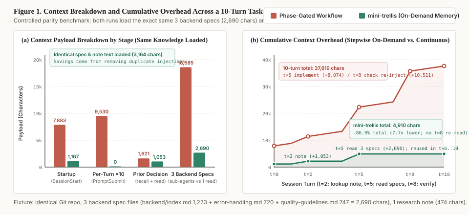

<h1 align="center">mini-trellis</h1>

<p align="center"><strong>Project knowledge for the next coding session.</strong></p>

<p align="center">Keep conventions, research and development notes for your agent.<br/>Find earlier decisions and their sources when you need them again.</p>

<p align="center">Local Markdown · On-demand lookup · Across sessions</p>

<p align="center">
  <a href="#quick-start">Quick start</a> ·
  <a href="#working-with-project-memory">How it works</a> ·
  <a href="#context-overhead">Context overhead</a> ·
  <a href="#migrating-from-trellis">Migration</a> ·
  <a href="./README_CN.md">简体中文</a>
</p>

<p align="center">
  <a href="https://www.npmjs.com/package/mini-trellis"></a>
  <a href="./LICENSE"></a>
</p>


- **Carry decisions forward.** Keep agreed interface boundaries and project conventions where the next session can read them.
- **Build on earlier research.** Save the conclusion, its conditions and its sources. Update the same topic as you learn more.
- **Check the original discussion.** Search local conversation history when you need to distinguish a proposal from the decision that followed.

mini-trellis adds project memory to your existing way of working. Planning, implementation and review stay with you and your agent. Knowledge is stored as editable Markdown; history lookup runs locally, without an embedding model or a separate retrieval service.

## Quick start

v0.2.2 streamlines the session-start entry and automatically cleans legacy workflow hooks during migration. See the [release notes](./docs/releases/v0.2.2.md).

Requires **Node.js ≥ 18.17**, **Python ≥ 3.9**, and Git for version control.

Run in your project:

```bash
npm install -g mini-trellis
mini-trellis init -u your-name --claude
```

Choose your agent's flag from the [supported tools](#supported-tools) below. Flags can be combined.

You can also hand this to the agent you are already using:

```text
Install or migrate mini-trellis in this project. If the command is missing, run npm install -g mini-trellis first.
If this project has legacy workflow files (for example .trellis/workflow.md, .trellis/scripts/task.py, or inject-*.py), run mini-trellis migrate --dry-run, show me the plan, and run mini-trellis migrate -y after I confirm.
If this is a new project, run mini-trellis init -u <name> -y with only the tools I actually use (--claude, --codex, --opencode, --pi).
Then run mini-trellis doctor and report the result. Do not delete .trellis/spec, .trellis/research, or .trellis/workspace.
```

Start a new agent session. Once you have a decision worth keeping, ask the agent to save it and invoke its `remember` command. To look up project knowledge from the terminal:

```bash
mini-trellis mem recall "callback retries"
```

## Working with project memory

Consider a billing service where repeated callbacks caused duplicate charges. The fix is complete, but the reason for it needs to survive the session.

| Keep | Example | Use it next time |
| --- | --- | --- |
| A project convention | Every callback must carry an idempotency key. | Check the rule before changing the callback handler. |
| Research and evidence | Retry conditions, alternatives considered, and links to the provider's documentation. | Revisit the reasoning when the provider changes its API. |
| A development note | What caused the duplicate charge, what changed, and which test verified the fix. | Find the earlier investigation when a similar report arrives. |

The agent saves these findings as project notes, ready to consult and update in later sessions.

### Where knowledge lives

| Location | Contents |
| --- | --- |
| `.trellis/spec/` | Current project conventions and durable contracts. Read the relevant `index.md` first. |
| `.trellis/research/` | Topic notes with conclusions, conditions and sources. Historical topics can be kept under `archive/`. |
| `.trellis/workspace/<you>/` | Your session journals: changes, decisions, verification and next steps. |
| Your agent's local history | Original conversations, searched in place with `mini-trellis mem`. |

The Markdown files can be reviewed, edited and versioned in Git. Check your ignore rules if you want to share them with the team. Original conversations remain in the agent's own local store.

### During a session

At startup, the configured hook supplies knowledge locations and recording guidance. The agent can read the relevant notes while working and search history when a previous decision matters.

Record confirmed decisions, reusable findings and verified fixes. Update an existing topic when it already covers the subject; keep the journal brief and link to the detailed note. Use `mini-trellis-update-spec` to capture a lasting project rule.

Use `remember` to save a checkpoint before ending a session. New installations write notes without an automatic Git commit; existing projects follow their `session_auto_commit` setting.

### Find project knowledge

`recall` searches project Markdown and past conversations together. It discovers documents automatically and returns short excerpts with their sources. Copy a result's `ref` into `read` to expand it:

```bash
mini-trellis mem recall "callback retries"
mini-trellis mem read "<ref>"
```

Lookup stays within the current project. Results are kept short; expand the sources you need. `read` checks for source changes before returning the text.

For conversation-only lookup, use `mem search`, then `mem context` with a returned session ID. See `mini-trellis mem help` for commands and filters.

## Supported tools

| Agent | Initialization flag | Record a session |
| --- | --- | --- |
| Claude Code | `--claude` | `/mini-trellis:remember` |
| Codex | `--codex` | `$mini-trellis-remember` |
| OpenCode | `--opencode` | `/mini-trellis:remember` |
| Pi | `--pi` | `/mini-trellis-remember` |

For example, add both Claude Code and Codex with `mini-trellis init -u your-name --claude --codex`.

For Codex:

1. Run `codex` in the project and review the project trust prompt. If project-local configuration is disabled, follow Codex's message to trust the resolved project path in `~/.codex/config.toml`.
2. Open `/hooks` to review and approve the project hook. Project trust and hook trust are separate checks; an `untrusted` hook stays inactive.
3. If your Codex version requires the opt-in, set `hooks = true` under `[features]` in the user config.
4. Run `mini-trellis doctor`, then start a new session. Hook delivery remains `unknown` until a real run is observed.

## Upgrade and check an installation

`upgrade` updates the global CLI. `refresh` updates the project's installed scripts and agent files.

Back up `.trellis/`, `AGENTS.md` and the configured agent directories first, including ignored files. Then:

```bash
mini-trellis upgrade
mini-trellis refresh --dry-run
```

Review the preview before applying it:

```bash
mini-trellis refresh
mini-trellis doctor
```

Refresh updates only managed assets that have not been modified locally. It preserves knowledge and custom configuration, and reports conflicts for you to resolve. Open a new agent session after refreshing.

Use `mini-trellis platforms` to inspect configured tools. To remove an installation, check `mini-trellis uninstall --help` first: uninstall removes `.trellis/`, including knowledge files, so back them up before removal.

## Context overhead

A phase-gated workflow injects state or specs at session start, on every user prompt, and whenever a sub-agent starts. mini-trellis keeps only a short startup entry; prior decisions and project specs are read when needed, stay in the main session context, and are not re-injected.



Measured on the same repository fixture across a 10-turn backend task, where both runs load the same three backend spec files (`backend/index.md`, `error-handling.md`, `quality-guidelines.md`, 2,690 chars total) and the same research note (474 chars):

| Stage | Phase-Gated Workflow | mini-trellis | What changed |
| --- | --- | --- | --- |
| Session start (`SessionStart`) | 7,883 chars | 1,167 chars | Drops the workflow manual and full directory tree; keeps current state and lookup commands. |
| Every turn (`UserPromptSubmit`, 10 turns) | 9,530 chars (953 / turn) | 0 chars | No per-turn state hook. |
| Prior decision lookup | 1,621 chars (`research` sub-agent) | 1,053 chars (`mem recall` 579 + `mem read` 474) | Finds the topic via a short excerpt, then reads the full note. |
| Project specs | 18,585 chars (`implement` 8,074 + `check` 10,511) | 2,690 chars | Reads the 3 spec files once in the main session instead of re-injecting specs and task wrappers into two cold-start sub-agents. |
| **10-turn total** | **37,619 chars** | **4,910 chars** | **Identical spec and note text loaded; 86.9% less injected context (7.7×).** |

On a production repository with 19 domain spec files (137k chars) and 262 migrated research notes (2.37M chars), mini-trellis startup stays at 1,171 chars, while `Phase-Gated Workflow` `implement` + `check` sub-agent injections reach 127k–512k chars per task.

## Migrating from Trellis

Trellis projects can be converted with `migrate`. The two tools share `.trellis/`; use migration to replace the existing integration rather than installing both into the same project.

```bash
mini-trellis migrate --dry-run
mini-trellis migrate
```

Migration retains existing spec, research and journals, and moves task research into research topics. Other task material is archived under `legacy/` by default; deletion is an explicit choice. Trellis-specific workflow files are removed, while scripts, configuration and detected host integrations are replaced with mini-trellis versions.

Before migration, back up project knowledge and custom configuration, including Git-ignored files. The migration command does not create backups. It asks for confirmation and defaults to no.

See the [migration guide](./docs/migration.md) for path mappings, retained files, conflicts and link handling. Use `refresh` to update an existing mini-trellis installation.

## Contributing

Bug reports and practical examples are welcome in [Issues](https://github.com/Tiger-zzZ/mini-trellis/issues). For local development, see [CONTRIBUTING](./CONTRIBUTING.md). Community: [Linux.do](https://linux.do/).

## Acknowledgments and license

mini-trellis evolved from the open-source [Trellis](https://github.com/mindfold-ai/Trellis) project. Thanks to the early contributors for the foundation.

[AGPL-3.0](./LICENSE). Original copyright Mindfold LLC; modification notices and contributor attribution are retained in [COPYRIGHT](./COPYRIGHT).
