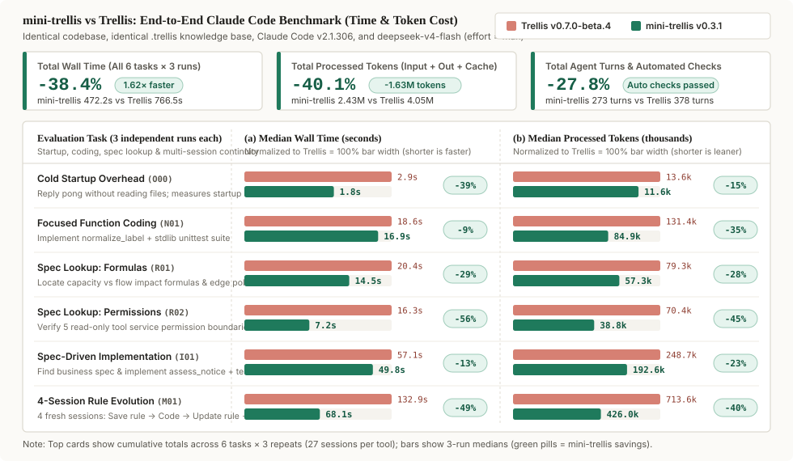

<h1 align="center">mini-trellis</h1>

<p align="center"><strong>Cross-session memory for AI coding agents — without the heavy workflow tax.</strong></p>

<p align="center">
  Keep architectural conventions, research conclusions, and verified fixes in plain Markdown, and search local agent conversations in place.<br/>
  <strong>38.4% less wall time (1.62×)</strong> and <strong>40.1% fewer processed tokens</strong> in Claude Code benchmarks; <strong>86.9% fewer injected context characters</strong> across a 10-turn task fixture.
</p>

<p align="center">Local Markdown · Zero Vector DB · On-Demand Recall &amp; Recording · One-Command Migration from Trellis</p>

<p align="center">
  <a href="#measured-performance--context-overhead">Benchmarks</a> ·
  <a href="#why-mini-trellis">Comparison</a> ·
  <a href="#quick-start">Quick start</a> ·
  <a href="#working-with-project-memory">How it works</a> ·
  <a href="./docs/using.md">During a change</a> ·
  <a href="#supported-tools">Supported agents</a> ·
  <a href="#migrating-from-trellis--upgrading">Migration</a> ·
  <a href="./README_CN.md">简体中文</a>
</p>

<p align="center">
  <a href="https://www.npmjs.com/package/mini-trellis"></a>
  <a href="./LICENSE"></a>
</p>


AI coding workflows often fall into one of two traps: **starting every session with amnesia**—re-explaining the same API boundaries and past bugs—or **strapping on a heavy phase-gated workflow** that injects thousands of characters at startup, re-injects state on every prompt, and spawns cold-start sub-agents for routine edits.

**mini-trellis keeps the project memory layer and leaves your workflow alone:**

- **Carry decisions across sessions.** Interface contracts (`spec`), technical investigations (`research`), and session journals (`workspace`) live in versioned project Markdown—ready to consult and update as your codebase evolves.
- **Unified lookup over docs and past chats.** When prior context matters, `mini-trellis mem recall` searches project Markdown and local agent conversation history together, returning short excerpts first and expanding full text via `ref` only when needed.
- **Local-first, zero external services.** No vector database, no embedding API keys, and no background daemon. Planning, coding, and review stay completely with you and your agent.

---

## Why mini-trellis

| Dimension | Hand-maintained `CLAUDE.md` | Vector DB / RAG Memory MCP | Phase-Gated Workflow (Trellis) | **mini-trellis** |
| --- | --- | --- | --- | --- |
| **Startup & per-turn injection** | Grows unbounded; loaded into every session | Plugin-dependent; extra indexing & network latency | ~8.6k chars at startup + per-turn state + sub-agent re-injection | **~1.1k chars at startup; 0 per-turn injection** |
| **How specs & notes are loaded** | Always in context, even when irrelevant | Opaque similarity chunks; easy to miss exact contracts | Cold-start sub-agents re-read specs repeatedly | **On-demand `mem recall` excerpts; `mem read` only when needed** |
| **Past conversation lookup** | None—lost when the chat closes | Requires syncing chats into an external store | Relies on manual task directory artifacts | **Searches local Claude / Codex / OpenCode / Pi sessions in place** |
| **Knowledge evolution** | Manual pruning; stale rules linger | Old and updated decisions collide in vector space | Scattered across archived task folders | **Built-in `superseded` lineage lifts current rules above old ones** |
| **Infrastructure & ceremony** | Plain file, no search | Database, embeddings, and service config | Mandatory phase gates and sub-agent templates | **Plain Git-friendly Markdown + lightweight CLI; no forced workflow** |

---

## Measured performance & context overhead

We report two distinct measurements below: **1) end-to-end wall time and processed tokens on Claude Code (`-38.4%` time, `-40.1%` processed tokens)**, and **2) static injected character counts across a 10-turn task fixture (`-86.9%` injected characters)**. They measure different layers and are kept separate.

### 1. End-to-end Claude Code benchmark (38.4% less wall time, 40.1% fewer processed tokens)

Under identical conditions—**same project code, same `.trellis` knowledge base, same Claude Code (`v2.1.306`), and same model (`deepseek-v4-flash`, `effort = max`)**—we compared `mini-trellis v0.3.1` against `Trellis v0.7.0-beta.4` across 6 task groups × 3 independent runs (27 sessions per tool):



| Evaluation Task | Scenario | Median Time (mini / Trellis) | Time Saved | Median Processed Tokens (mini / Trellis) | Tokens Saved | Automated Check |
| --- | --- | :---: | :---: | :---: | :---: | :---: |
| **Cold Startup Overhead** (`O00`) | Reply `pong` without reading files; measures startup hook | **1.8s** / 2.9s | `-39.3%` | **11.6k** / 13.6k | `-14.8%` | Startup only (3/3 done) |
| **Focused Function Coding** (`N01`) | Implement `normalize_label` + `unittest` from docstring | **16.9s** / 18.6s | `-9.2%` | **84.9k** / 131.4k | `-35.4%` | Unit tests 3/3 pass |
| **Spec Lookup: Formulas** (`R01`) | Find capacity vs. flow impact formulas & edge policies | **14.5s** / 20.4s | `-28.8%` | **57.3k** / 79.3k | `-27.8%` | Formula & policy 3/3 pass |
| **Spec Lookup: Permissions** (`R02`) | Verify 5 read-only tool service permission boundaries | **7.2s** / 16.3s | `-55.9%` | **38.8k** / 70.4k | `-44.9%` | Booleans & quote 3/3 pass |
| **Spec-Driven Implementation** (`I01`) | Locate business spec & implement `assess_notice` + tests | **49.8s** / 57.1s | `-12.7%` | **192.6k** / 248.7k | `-22.6%` | 27 test cases 3/3 pass |
| **4-Session Rule Evolution** (`M01`) | 4 fresh sessions: Save rule → Code → Update rule → Re-code | **68.1s** / 132.9s | `-48.8%` | **426.0k** / 713.6k | `-40.3%` | Both code stages 3/3 pass |
| **All Recorded Runs Cumulative** | **Actual sum across all 6 tasks × 3 repeats (27 sessions/side)** | **472.2s** / 766.5s | **`-38.4%` (1.62×)** | **2.43M** / 4.05M | **`-40.1%` (-1.63M)** | **All automated checks pass** |

- **Metric definitions**: Wall time is measured from command start to exit (including tool execution). **Processed tokens** = uncached input + output + cache reads (measuring total context volume processed across turns, not billed USD cost). Automated checks cover external unit test suites for coding tasks and numeric formula probes, boolean checks, and quotation matching for read tasks.
- Full experimental setup, task designs, per-session numbers across all 54 sessions, and the 4-stage continuity breakdown are in the [Detailed Benchmark Report](./docs/releases/benchmark-detail.md) (release overview in the [v0.3.1 Release Notes](./docs/releases/v0.3.1.md)).

### 2. Injected character breakdown: why is the context lighter? (86.9% fewer injected characters)

The chart below measures **hook and sub-agent injected text length in characters** on the v0.2.2 fixture (static and repeated prompt injection volume, distinct from the runtime token totals above). A phase-gated workflow injects state or specs at session start, on every user prompt, and whenever a sub-agent starts; `mini-trellis` keeps only a short startup entry and reads specs once in the main session when needed:


Measured on the same repository fixture across a 10-turn backend task, where both runs load the same three backend spec files (`2,690 chars`) and the same research note (`474 chars`):

| Stage | Phase-Gated Workflow | mini-trellis | What changed |
| --- | ---: | ---: | --- |
| Session start (`SessionStart`) | 7,883 chars | **1,167 chars** | Drops the workflow manual and full directory tree; keeps current state and lookup commands |
| Every turn (`UserPromptSubmit` ×10) | 9,530 chars | **0 chars** | No per-turn state hook |
| Prior decision lookup (`recall` + `read`) | 1,621 chars | **1,053 chars** | Finds the topic via a 579-char excerpt, then reads the 474-char note |
| Project specs (3 backend spec files) | 18,585 chars | **2,690 chars** | Reads the 3 spec files once in the main session instead of re-injecting into two cold-start sub-agents |
| **10-turn cumulative injected chars** | **37,619 chars** | **4,910 chars** | **Identical spec and note text loaded; 86.9% fewer injected characters (7.7×)** |

On a production repository with 19 domain spec files (`137k chars`) and 262 migrated research notes (`2.37M chars`), `mini-trellis` startup stays at **1,171 chars**, while phase-gated `implement` + `check` sub-agent injections reach **127k–512k chars** per task.

---

## Quick start

Requires **Node.js ≥ 18.17**, **Python ≥ 3.9**, and Git.

### 1. Install and initialize

Run in your project root:

```bash
npm install -g mini-trellis
mini-trellis init -u your-name --claude
```

Choose or combine flags for the agents you use (`--claude`, `--cursor`, `--codex`, `--opencode`, `--pi`, `--dsh`). You can also hand this prompt directly to your agent to install or migrate from Trellis:

```text
Install or migrate mini-trellis in this project. If the command is missing, run npm install -g mini-trellis first.
If this project has legacy workflow files (for example .trellis/workflow.md, .trellis/scripts/task.py, or inject-*.py), run mini-trellis migrate --dry-run, show me the plan, and run mini-trellis migrate -y after I confirm.
If this is a new project, run mini-trellis init -u <name> -y with only the tools I actually use (--claude, --codex, --opencode, --pi, --dsh, --cursor).
Then run mini-trellis doctor and report the result. Do not delete .trellis/spec, .trellis/research, or .trellis/workspace.
```

### 2. Record a decision worth keeping

Start a new agent session. For routine edits, just write code. Once you reach a decision or root-cause fix that a future session should know about, ask the agent to save it and run its `remember` command (for example `/mini-trellis:remember` in Claude Code):

```text
Confirmed: every callback must carry an idempotency key, and transient failures retry up to 4 attempts total (upstream confirmed idempotency).
Update the relevant spec or research note, then run remember for this session.
```

The agent updates `.trellis/spec/` or `.trellis/research/` and writes a short entry in `.trellis/workspace/<you>/` linking to that note.

### 3. Recall it in a later session

When a later session touches that area—or when you want to check prior reasoning from the terminal—run `recall` to search project Markdown and local conversation history together:

```bash
mini-trellis mem recall "callback retries"
```

`recall` returns short excerpts, source paths, and `<ref>` handles generated for your project:

```text
[doc] .trellis/spec/backend/callback-retries.md:1  § Callback retries  strong
  ref: <ref-from-recall>
  Transient failures retry up to 4 attempts total (including the initial attempt) after upstream confirmed idempotency; permanent failures run once.

[session] claude:a8f2c104  strong
  ref: <ref-from-recall>
  Updated transient callback max_attempts from 2 to 4 after upstream confirmed idempotency guarantees.
```

**Usually the short excerpt is enough to proceed.** Only when you need the full section or original conversation turns, copy the `<ref>` printed by `recall` into `read`:

```bash
mini-trellis mem read "<ref>"
```

---

## Working with project memory

Consider a billing service where repeated callbacks caused duplicate charges. Once fixed, the rule and its rationale stay in the project for future sessions:

| What to keep | Location | Example | When a future session uses it |
| --- | --- | --- | --- |
| **Project conventions (`spec`)** | `.trellis/spec/` | Every callback must carry an idempotency key (read `index.md` first) | Before changing the callback handler or boundary contract |
| **Research & evidence (`research`)** | `.trellis/research/` | Retry conditions, alternatives considered, and provider docs (archive old topics under `archive/`) | When the provider changes its API and you need the original rationale |
| **Development notes (`workspace`)** | `.trellis/workspace/<you>/` | Root cause of the duplicate charge, files changed, and verifying tests | When a similar bug report arrives and you want the prior investigation |
| **Local chat history (`mem`)** | Agent's local session store | Original discussion turns, searched in place with `mini-trellis mem` | When distinguishing a rejected proposal from the final agreed decision |

### On-demand, not a mandatory ceremony

- **Just code for routine changes.** You do not create a task before editing, and you do not have to run `remember` at the end of every chat.
- **Look up only when context is missing.** Run `mem recall` when touching unfamiliar rules or prior decisions; stop at the excerpt if it answers your question, and run `mem read "<ref>"` only when you need the full text. For conversation-only search, use `mem search` and `mem context <session-id>`.
- **Record only what future sessions need.** Update an existing topic note when rules evolve, promote lasting boundaries with `mini-trellis-update-spec`, and run `remember` when a session produced a reusable conclusion. New installations write files without auto-committing to Git.

> Walk through a concrete change in [During a change](./docs/using.md).

---

## Supported tools

Combine flags as needed (for example, `mini-trellis init -u your-name --claude --cursor`):

| Agent | Init flag | Record a session | Knowledge & history support |
| --- | --- | --- | --- |
| **Claude Code** | `--claude` | `/mini-trellis:remember` | `SessionStart` injects the short entry; searches project docs and `~/.claude/projects` history |
| **Cursor** | `--cursor` | `mini-trellis-remember` | Installs `.cursor/skills/`; local sessions inject the short entry via `sessionStart` (cloud agents do not run the hook) |
| **Codex** | `--codex` | `$mini-trellis-remember` | Project hook injection and local session history search |
| **OpenCode** | `--opencode` | `/mini-trellis:remember` | Startup entry and local session search (including `--include-children` sub-agent merging) |
| **Pi** | `--pi` | `/mini-trellis-remember` | Startup entry and local session search |
| **DeepSeek Harness** | `--dsh` | `mini-trellis-remember` | Installs `.dsh/skills/`; no project `SessionStart` hook—the model calls `mem recall` / `mem read` when needed |

<details>
<summary><strong>Codex trust setup &amp; host-specific boundaries</strong></summary>

- **Codex first-time setup**:
  1. Run `codex` in the project and review the project trust prompt. If project-local configuration is disabled, trust the resolved project path in `~/.codex/config.toml`.
  2. Open `/hooks` to review and approve the project hook (`untrusted` hooks stay inactive).
  3. If required by your Codex version, set `hooks = true` under `[features]` in the user config.
  4. Run `mini-trellis doctor`, then start a new session.
- **Host boundaries**:
  - DeepSeek Harness has no project-level `SessionStart` hook and does not parse compressed transcripts in `~/.dsh/sessions`;
  - Cursor local sessions run `sessionStart`, while Cursor cloud agents carry the repo skills without running `sessionStart`; Cursor conversation history is not parsed;
  - OpenCode and Pi support session listing and search without precise compact boundary recovery. See the [v0.3.1 release notes](./docs/releases/v0.3.1.md).

</details>

---

## Migrating from Trellis & upgrading

Existing `Trellis` projects can be converted in place with `migrate` (both tools share `.trellis/`, so migrate rather than installing both side by side):

```bash
mini-trellis migrate --dry-run   # Preview the migration plan
mini-trellis migrate             # Apply after confirmation
```

- **Retains existing knowledge**: Keeps `.trellis/spec/`, `.trellis/research/`, and `.trellis/workspace/` journals intact.
- **Folds task directories cleanly**: Moves task research into `.trellis/research/`, archives other task artifacts under `legacy/` by default, and replaces Trellis workflow files and scripts with `mini-trellis`.

<details>
<summary><strong>Upgrading (`upgrade` / `refresh`) &amp; uninstalling</strong></summary>

Back up `.trellis/`, `AGENTS.md`, and configured agent directories (including Git-ignored files) before migrating or refreshing:

```bash
mini-trellis upgrade             # Update the global CLI
mini-trellis refresh --dry-run   # Preview managed asset updates
mini-trellis refresh             # Update unmodified managed files while preserving knowledge
mini-trellis doctor              # Check installation status
```

- Inspect configured tools with `mini-trellis platforms`.
- Before running `mini-trellis uninstall`, check `mini-trellis uninstall --help`: uninstall removes `.trellis/`, including knowledge files. See the [migration guide](./docs/migration.md) for path mappings and conflict handling.

</details>

---

## Contributing & license

Bug reports and practical examples are welcome in [Issues](https://github.com/Tiger-zzZ/mini-trellis/issues). For local development, see [CONTRIBUTING](./CONTRIBUTING.md). Community: [Linux.do](https://linux.do/).

mini-trellis evolved from the open-source [Trellis](https://github.com/mindfold-ai/Trellis) project. Thanks to the early contributors for the foundation. Released under [AGPL-3.0](./LICENSE). Original copyright Mindfold LLC; modification notices and contributor attribution are retained in [COPYRIGHT](./COPYRIGHT).
