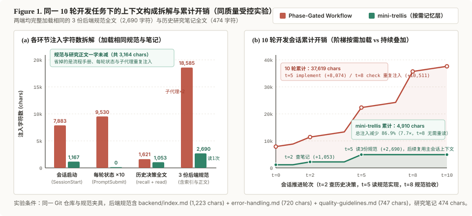

<h1 align="center">mini-trellis</h1>

<p align="center"><strong>让项目知识，延续到下一次开发。</strong></p>

<p align="center">为 Agent 保存项目约定、研究结论和开发记录。<br/>需要时找回已有决定与原始出处，让后续工作有据可循。</p>

<p align="center">本地 Markdown · 按需检索 · 跨会话复用</p>

<p align="center">
  <a href="#快速开始">快速开始</a> ·
  <a href="#知识如何留下并再次使用">工作方式</a> ·
  <a href="#上下文开销">上下文开销</a> ·
  <a href="#从-trellis-迁移">迁移指南</a> ·
  <a href="./README.md">English</a>
</p>

<p align="center">
  <a href="https://www.npmjs.com/package/mini-trellis"></a>
  <a href="./LICENSE"></a>
</p>


- **约定可以沿用。** 已确认的接口边界和项目规范留在项目里，供下一次开发查阅。
- **研究可以积累。** 保存结论、适用条件与资料来源，有新发现时继续更新同一主题。
- **历史可以查证。** 从本地对话找回讨论原文，分清当时的提议、否定和最终决定。

mini-trellis 为现有开发方式补上项目记忆，规划、实现和验收由你与 Agent 决定。知识保存在可编辑的 Markdown 中；历史检索在本地运行，无需嵌入模型或独立检索服务。

## 快速开始

v0.2.2 进一步收窄会话启动入口，并在迁移时自动清理残留的旧工作流配置。见[版本说明](./docs/releases/v0.2.2.md)。

需要 **Node.js ≥ 18.17**、**Python ≥ 3.9**，以及用于版本管理的 Git。

在项目目录执行：

```bash
npm install -g mini-trellis
mini-trellis init -u your-name --claude
```

按下方[支持的工具](#支持的工具)选择初始化参数，也可以组合多个参数。

也可以把下面这段交给正在使用的 Agent，让它安装或从 Trellis 迁移：

```text
请在当前项目安装或迁移 mini-trellis。若还没有命令，先执行 npm install -g mini-trellis。
如果项目里已有旧版工作流文件（例如 .trellis/workflow.md、.trellis/scripts/task.py，或 inject-*.py），先运行 mini-trellis migrate --dry-run，把计划给我看，确认后再执行 mini-trellis migrate -y。
如果是新项目，运行 mini-trellis init -u <name> -y，并只加上我实际使用的工具参数（--claude、--codex、--opencode、--pi）。
最后运行 mini-trellis doctor，并说明结果。不要删除 .trellis/spec、.trellis/research 或 .trellis/workspace。
```

重新开启 Agent 会话。有值得保留的结论时，让 Agent 保存，并调用对应的 `remember` 命令。也可以在终端查找项目知识：

```bash
mini-trellis mem recall "回调 重试"
```

## 知识如何留下并再次使用

以一个支付服务为例：重复回调曾导致重复扣款。问题已经修好，修复依据也需要留下。

| 留下什么 | 内容示例 | 下次如何使用 |
| --- | --- | --- |
| 项目约定 | 每个回调必须携带幂等键。 | 修改回调接口前，先查阅已有约定。 |
| 研究与依据 | 重试条件、考虑过的方案，以及支付平台文档链接。 | 平台 API 变化时，重新核对当初的选择。 |
| 开发记录 | 重复扣款的原因、修改内容，以及验证修复的测试。 | 收到相似故障报告时，找到之前的排查记录。 |

Agent 将这些结论写入项目笔记，后续会话可以继续查阅和更新。

### 知识保存在哪里

| 位置 | 内容 |
| --- | --- |
| `.trellis/spec/` | 当前项目约定和长期有效的规则，先读相关的 `index.md`。 |
| `.trellis/research/` | 按主题保存研究结论、条件和出处，历史主题可放入 `archive/`。 |
| `.trellis/workspace/<你>/` | 个人开发日志：做了什么、定了什么、如何验证、下一步是什么。 |
| Agent 的本地历史目录 | 原始对话，通过 `mini-trellis mem` 就地检索。 |

Markdown 可以直接阅读、修改，也可以纳入 Git 版本管理。需要与团队共享时，请检查项目的忽略规则。原始对话仍保存在各 Agent 自己的本地目录中。

### 日常怎样使用

会话开始时，已配置的 hook 提供知识入口和记录提示。开发过程中，Agent 按需阅读相关笔记；遇到历史决定时，再查询以前的对话。

已确认的决定、可复用的研究和验证过的故障解法值得记录。已有相关主题就更新原文件；journal 简记过程，并链接到详细笔记。长期项目规则可以通过 `mini-trellis-update-spec` 保存。

结束会话前，可以调用 `remember` 保存当前进展。新安装默认只写文件，不自动 Git commit；已有项目遵循原来的 `session_auto_commit` 配置。

### 查找项目知识

`recall` 同时检索项目 Markdown 和历史对话，自动发现文档，无需配置检索来源。结果包含短摘录与出处，将其中的 `ref` 复制给 `read` 即可展开：

```bash
mini-trellis mem recall "回调 重试"
mini-trellis mem read "<ref>"
```

检索限定在当前项目，先看简短结果，再按需读取原文。展开时，`read` 会检查来源是否发生变化。

只查历史对话时，可以使用 `mem search`，再将返回的 session ID 交给 `mem context` 查看上下文。完整命令与筛选选项见 `mini-trellis mem help`。

## 支持的工具

| Agent | 初始化参数 | 记录当前会话 |
| --- | --- | --- |
| Claude Code | `--claude` | `/mini-trellis:remember` |
| Codex | `--codex` | `$mini-trellis-remember` |
| OpenCode | `--opencode` | `/mini-trellis:remember` |
| Pi | `--pi` | `/mini-trellis-remember` |

例如，同时配置 Claude Code 和 Codex：`mini-trellis init -u your-name --claude --codex`。

使用 Codex 时：

1. 在项目目录运行 `codex`，审查项目信任提示。若项目配置被禁用，按 Codex 的提示在 `~/.codex/config.toml` 信任解析后的项目路径。
2. 打开 `/hooks`，审核并批准项目 hook。项目信任与 hook 信任分别检查，`untrusted` hook 保持停用。
3. 当前版本要求显式开启时，在用户配置的 `[features]` 中设置 `hooks = true`。
4. 运行 `mini-trellis doctor`，再开启新会话。尚未观察到真实 hook 运行时，交付状态显示为 `unknown`。

## 升级与检查

`upgrade` 更新全局 CLI，`refresh` 更新项目中已安装的脚本和 Agent 文件。

先备份 `.trellis/`、`AGENTS.md` 和已配置的 Agent 目录，包括被 Git 忽略的文件，再执行：

```bash
mini-trellis upgrade
mini-trellis refresh --dry-run
```

查看预览后应用更新：

```bash
mini-trellis refresh
mini-trellis doctor
```

Refresh 只更新受管理且未被本地修改的文件，保留知识和自定义配置，并报告需要处理的冲突。完成后重新开启 Agent 会话。

`mini-trellis platforms` 可以查看已配置的工具。需要卸载时，先查看 `mini-trellis uninstall --help`：卸载会移除 `.trellis/`，包括知识文件，请先备份。

## 上下文开销

`Phase-Gated Workflow` 在每次会话启动、每一轮用户输入、每次派发子代理时都会注入状态或规范。mini-trellis 只保留启动时的短入口；历史结论和项目规范在需要时读取，留在主会话上下文里，不再重复注入。



在同一测试仓库中完成一次 10 轮后端修改任务，两边读取相同的 3 份后端规范（`backend/index.md`、`error-handling.md`、`quality-guidelines.md`，共 2,690 字符）和同一篇研究笔记（474 字符）：

| 环节 | Phase-Gated Workflow | mini-trellis | 差异来源 |
| --- | --- | --- | --- |
| 会话启动 (`SessionStart`) | 7,883 字符 | 1,167 字符 | 去掉四阶段流程说明和全量目录树，只保留当前状态与查找入口。 |
| 每轮对话 (`UserPromptSubmit`，10 轮) | 9,530 字符（953 / 轮） | 0 字符 | 不注册每轮状态 hook。 |
| 查找历史结论 | 1,621 字符（`research` 子代理） | 1,053 字符（`mem recall` 579 + `mem read` 474） | 先用摘录定位，再读取那篇研究笔记全文。 |
| 加载项目规范 | 18,585 字符（`implement` 8,074 + `check` 10,511） | 2,690 字符 | 主会话读取 3 份规范全文一次；不再向两个冷启动子代理重复注入规范与任务包装。 |
| **10 轮累计** | **37,619 字符** | **4,910 字符** | **规范与研究正文一字未减，总注入减少 86.9%（7.7×）。** |

在包含 19 份领域规范（13.7 万字符）与 262 篇迁移笔记（237 万字符）的真实生产仓库中，mini-trellis 的会话启动注入仍保持在 1,171 字符，而 `Phase-Gated Workflow` 单次任务的 `implement` + `check` 子代理注入达到 12.7 万～51.2 万字符。

## 从 Trellis 迁移

已有 Trellis 的项目可以通过 `migrate` 转换。两者共用 `.trellis/`，应通过迁移替换已有集成，避免两套指令同时生效。

```bash
mini-trellis migrate --dry-run
mini-trellis migrate
```

迁移保留已有 spec、research 和 journal，将任务中的研究内容转为 research topic。其他任务材料默认归档到 `legacy/`，只有明确选择时才删除。Trellis 专用流程文件会被移除，脚本、配置和检测到的宿主集成会替换成 mini-trellis 版本。

迁移前请备份项目知识和自定义配置，包括被 Git 忽略的文件。迁移命令不会自动创建备份，会询问确认，默认不执行。

完整路径映射、文件保留规则、冲突和链接处理见[迁移指南](./docs/migration_CN.md)。已有 mini-trellis 项目的常规更新使用 `refresh`。

## 参与项目

问题和实际使用案例可以提交到 [Issues](https://github.com/Tiger-zzZ/mini-trellis/issues)。本地开发说明见 [CONTRIBUTING_CN](./CONTRIBUTING_CN.md)。社区：[Linux.do](https://linux.do/)。

## 致谢与许可

mini-trellis 演进自开源项目 [Trellis](https://github.com/mindfold-ai/Trellis)。感谢早期贡献者奠定的基础。

[AGPL-3.0](./LICENSE)。原版权归 Mindfold LLC 所有，修改声明和贡献者署名保留在 [COPYRIGHT](./COPYRIGHT) 中。
