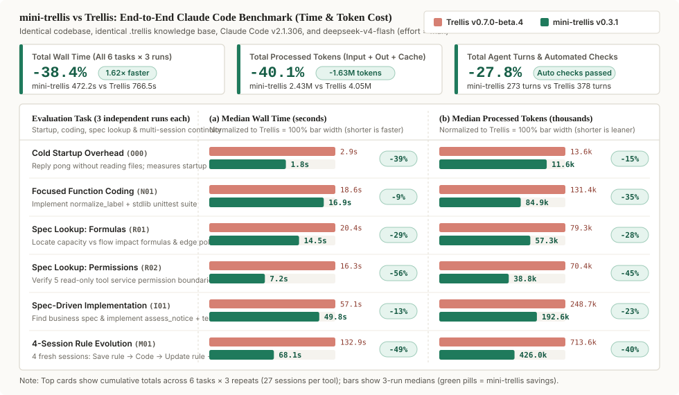
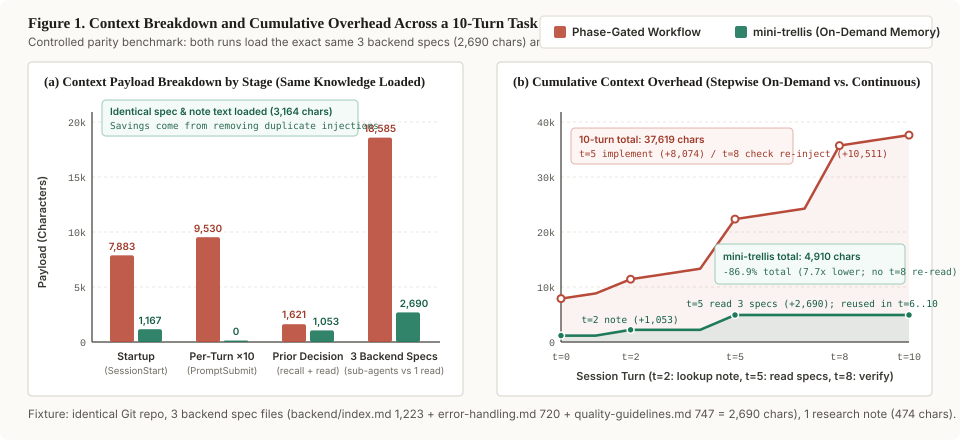

# Benchmarks

These measurements report the tested versions, fixtures, and agent configuration. The tables preserve the original test conditions.

We report two distinct measurements below: **1) end-to-end wall time and processed tokens on Claude Code (`-38.4%` time, `-40.1%` processed tokens)**, and **2) static injected character counts across a 10-turn task fixture (`-86.9%` injected characters)**. They measure different layers and are kept separate.

## End-to-end Claude Code benchmark

Under identical conditions—**same project code, same `.trellis` knowledge base, same Claude Code (`v2.1.306`), and same model (`deepseek-v4-flash`, `effort = max`)**—we compared `mini-trellis v0.3.1` against `Trellis v0.7.0-beta.4` across 6 task groups × 3 independent runs (27 sessions per tool):

| Evaluation Task | Scenario | Median Time (mini / Trellis) | Time Saved | Median Processed Tokens (mini / Trellis) | Tokens Saved | Automated Check |
| --- | --- | :---: | :---: | :---: | :---: | :---: |
| **Cold Startup Overhead** (`O00`) | Reply `pong` without reading files; measures startup hook | **1.8s** / 2.9s | `-39.3%` | **11.6k** / 13.6k | `-14.8%` | Startup only (3/3 done) |
| **Focused Function Coding** (`N01`) | Implement `normalize_label` + `unittest` from docstring | **16.9s** / 18.6s | `-9.2%` | **84.9k** / 131.4k | `-35.4%` | Unit tests 3/3 pass |
| **Spec Lookup: Formulas** (`R01`) | Find capacity vs. flow impact formulas & edge policies | **14.5s** / 20.4s | `-28.8%` | **57.3k** / 79.3k | `-27.8%` | Formula & policy 3/3 pass |
| **Spec Lookup: Permissions** (`R02`) | Verify 5 read-only tool service permission boundaries | **7.2s** / 16.3s | `-55.9%` | **38.8k** / 70.4k | `-44.9%` | Booleans & quote 3/3 pass |
| **Spec-Driven Implementation** (`I01`) | Locate business spec & implement `assess_notice` + tests | **49.8s** / 57.1s | `-12.7%` | **192.6k** / 248.7k | `-22.6%` | 27 test cases 3/3 pass |
| **4-Session Rule Evolution** (`M01`) | 4 fresh sessions: Save rule → Code → Update rule → Re-code | **68.1s** / 132.9s | `-48.8%` | **426.0k** / 713.6k | `-40.3%` | Both code stages 3/3 pass |
| **All Recorded Runs Cumulative** | **Actual sum across all 6 tasks × 3 repeats (27 sessions/side)** | **472.2s** / 766.5s | **`-38.4%` (1.62×)** | **2.43M** / 4.05M | **`-40.1%` (-1.63M)** | **All automated checks pass** |

- **Metric definitions**: Wall time is measured from command start to exit (including tool execution). **Processed tokens** = uncached input + output + cache reads (measuring total context volume processed across turns, not billed USD cost). Automated checks cover external unit test suites for coding tasks and numeric formula probes, boolean checks, and quotation matching for read tasks.
- Full experimental setup, task designs, per-session numbers across all 54 sessions, and the 4-stage continuity breakdown are in the [Detailed Benchmark Report](releases/benchmark-detail.md) (release overview in the [v0.3.1 Release Notes](releases/v0.3.1.md)).

## Injected characters in a 10-turn fixture

The chart below measures **hook and sub-agent injected text length in characters** on the v0.2.2 fixture (static and repeated prompt injection volume, distinct from the runtime token totals above). A phase-gated workflow injects state or specs at session start, on every user prompt, and whenever a sub-agent starts; `mini-trellis` keeps only a short startup entry and reads specs once in the main session when needed:

Measured on the same repository fixture across a 10-turn backend task, where both runs load the same three backend spec files (`2,690 chars`) and the same research note (`474 chars`):

| Stage | Phase-Gated Workflow | mini-trellis | What changed |
| --- | ---: | ---: | --- |
| Session start (`SessionStart`) | 7,883 chars | **1,167 chars** | Drops the workflow manual and full directory tree; keeps current state and lookup commands |
| Every turn (`UserPromptSubmit` ×10) | 9,530 chars | **0 chars** | No per-turn state hook |
| Prior decision lookup (`recall` + `read`) | 1,621 chars | **1,053 chars** | Finds the topic via a 579-char excerpt, then reads the 474-char note |
| Project specs (3 backend spec files) | 18,585 chars | **2,690 chars** | Reads the 3 spec files once in the main session instead of re-injecting into two cold-start sub-agents |
| **10-turn cumulative injected chars** | **37,619 chars** | **4,910 chars** | **Identical spec and note text loaded; 86.9% fewer injected characters (7.7×)** |

On a production repository with 19 domain spec files (`137k chars`) and 262 migrated research notes (`2.37M chars`), `mini-trellis` startup stays at **1,171 chars**, while phase-gated `implement` + `check` sub-agent injections reach **127k–512k chars** per task.
