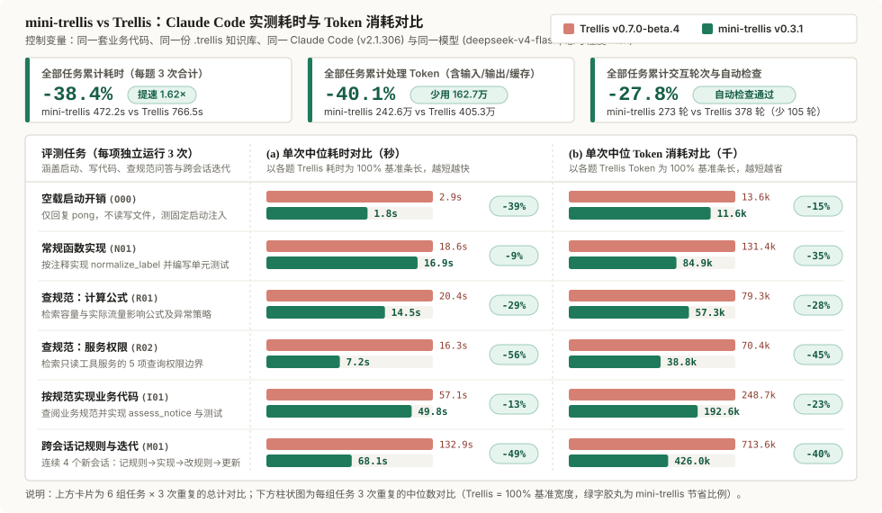
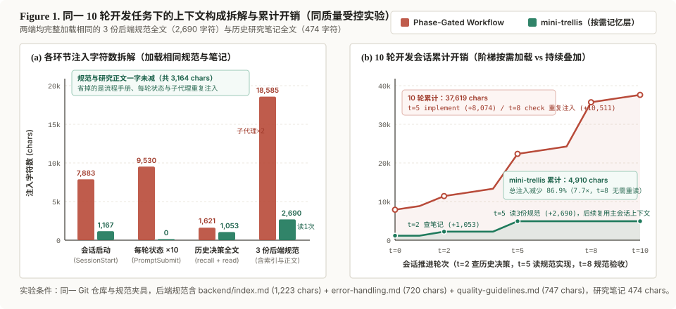

# 性能评测

以下数据按实际测试版本、任务夹具和 Agent 配置整理，表格保留当时的测试条件。

这里分两个维度展示数据：**一是 Claude Code 上的端到端任务实测耗时与处理 Token（减少 38.4% 耗时、40.1% 处理 Token）**；**二是 10 轮任务夹具上的静态注入字符数拆解（减少 86.9% 注入字符）**。两者口径不同，分开说明如下。

## Claude Code 端到端实测

在**同一套项目代码、同一份 `.trellis` 业务知识、同一个 Claude Code (`v2.1.306`) 与同一个模型（`deepseek-v4-flash`，思考程度 `max`）**下，对比 `mini-trellis v0.3.1` 与 `Trellis v0.7.0-beta.4`。6 组任务各独立运行 3 次（每侧 27 个会话）：

| 评测任务 | 考查场景 | 中位耗时 (mini / Trellis) | 耗时减少 | 中位处理 Token (mini / Trellis) | Token 减少 | 自动检查 |
| --- | --- | :---: | :---: | :---: | :---: | :---: |
| **空载启动开销** (`O00`) | 不读写文件仅回复 `pong`，测固定启动注入底噪 | **1.8s** / 2.9s | `-39.3%` | **11.6k** / 13.6k | `-14.8%` | 仅测启动 (3/3 完成) |
| **常规函数实现** (`N01`) | 按代码注释实现 `normalize_label` 并写单元测试 | **16.9s** / 18.6s | `-9.2%` | **84.9k** / 131.4k | `-35.4%` | 单元测试 3/3 通过 |
| **查规范：计算公式** (`R01`) | 从项目规范定位容量/流量计算公式与异常策略 | **14.5s** / 20.4s | `-28.8%` | **57.3k** / 79.3k | `-27.8%` | 公式与策略 3/3 通过 |
| **查规范：服务权限** (`R02`) | 从项目规范核对只读工具服务的 5 项权限边界 | **7.2s** / 16.3s | `-55.9%` | **38.8k** / 70.4k | `-44.9%` | 布尔与引文 3/3 通过 |
| **按规范实现业务代码** (`I01`) | 查阅业务规范并实现 `assess_notice` 核心逻辑与测试 | **49.8s** / 57.1s | `-12.7%` | **192.6k** / 248.7k | `-22.6%` | 27 项用例 3/3 通过 |
| **跨会话记规则与迭代** (`M01`) | 连续 4 个新会话：记规则 → 实现 → 改规则 → 更新实现 | **68.1s** / 132.9s | `-48.8%` | **426.0k** / 713.6k | `-40.3%` | 两阶段代码 3/3 通过 |
| **全部正式样本累计** | **6 组任务 × 3 次重复实际总和（非中位数相加）** | **472.2s** / 766.5s | **`-38.4%` (1.62×)** | **242.6万** / 405.3万 | **`-40.1%` (-162.7万)** | **自动检查全部通过** |

- **口径说明**：耗时为命令启动到结束的墙上时间（含工具执行）；**处理 Token** 为未缓存输入、输出与缓存命中读取之和（反映模型在多轮交互中处理的上下文总量，不等同于 API 账单费用）；自动检查涵盖代码题的外部单元测试与只读题的公式探针/布尔值/引文匹配校验。
- 实验环境、题目设计、全部 54 个会话的逐轮明细与跨会话四阶段拆解见 [《对比评测详细记录》](releases/benchmark-detail.md)（版本摘要见 [v0.3.1 版本说明](releases/v0.3.1.md)）。

## 十轮任务夹具的注入字符

下图展示的是 **Hook 与子代理注入文本的字符数对比**（v0.2.2 夹具数据，衡量固定与重复注入体积，而非端到端 Token 消耗）。阶段工作流在每次会话启动、每轮用户输入、每次派发子代理时都会注入状态或规范；`mini-trellis` 只保留启动短入口，规范与研究笔记按需读取一次后留在主会话上下文中：

在同一测试仓库中完成一次 10 轮后端修改任务，两边读取相同的 3 份后端规范（共 2,690 字符）和同一篇研究笔记（474 字符）：

| 环节 | 阶段门控工作流 | mini-trellis | 差异来源 |
| --- | ---: | ---: | --- |
| 会话启动 (`SessionStart`) | 7,883 字符 | **1,167 字符** | 去掉四阶段流程手册和全量目录树，只保留当前状态与查找入口 |
| 每轮对话 (`UserPromptSubmit` ×10) | 9,530 字符 | **0 字符** | 不注册每轮状态 Hook |
| 查找历史结论 (`recall` + `read`) | 1,621 字符 | **1,053 字符** | 先用 579 字符短摘录定位，再读 474 字符研究笔记全文 |
| 加载项目规范（3 份后端规范） | 18,585 字符 | **2,690 字符** | 主会话读取 3 份规范一次；不再向 `implement` + `check` 两个冷启动子代理重复注入 |
| **10 轮累计注入字符** | **37,619 字符** | **4,910 字符** | **规范与研究正文一字未减，注入字符数减少 86.9%（7.7×）** |

在包含 19 份领域规范（13.7 万字符）与 262 篇迁移笔记（237 万字符）的生产仓库中，`mini-trellis` 的会话启动注入仍保持在 **1,171 字符**，而阶段工作流单次任务的子代理注入达到 **12.7 万～51.2 万字符**。
