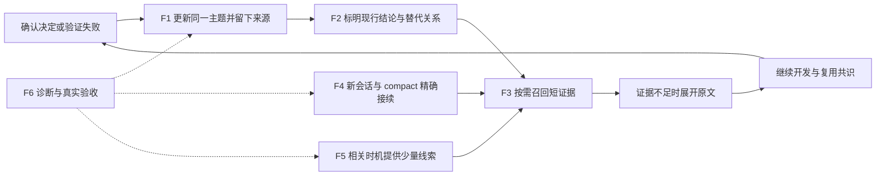
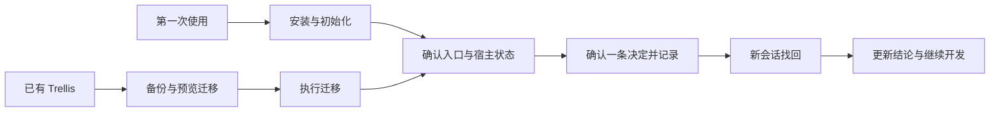
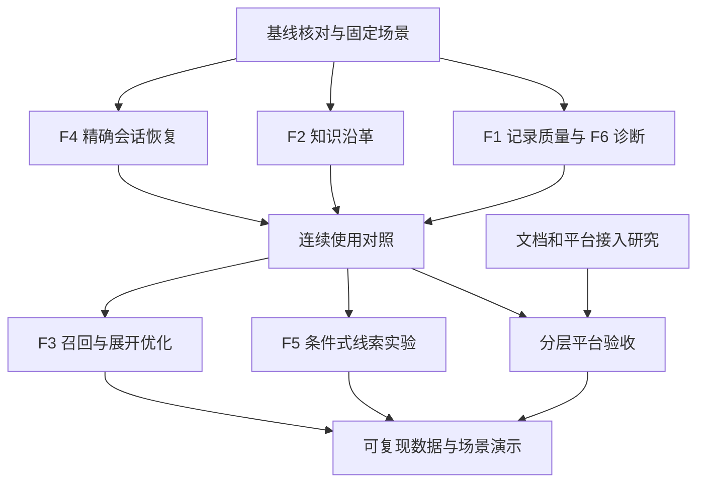

# mini-trellis 0.3 及后续开发计划

更新：2026-10-16。

本文整理已讨论的长期方向，供后续交接给 Cursor 开发。重点是功能主干的目标、最小实现、边界、依赖与验收。本文是实施计划，不表示其中功能已经完成，也不要求在一个版本内全部交付。

产品路线与阶段安排统一看 [roadmap](roadmap.md)；本文负责解释各项工作怎么做。正式开发时在相关工作包下补实际状态、提交与证据链接，避免再维护一份相互重复的计划。既有研究材料是依据与候选来源，较早的版本安排以本轮路线为准。

本文放在可纳入 Git 的 docs/ 下。仓库将 docs/plans/ 与 experiments/ 设为本地忽略目录；其中旧计划和验收材料属于可选背景，不是云端执行的必需依赖。本文件新增后仍需随用户后续提交进入远端，当前仅保存到工作区。

## 阅读导航

- [当前基线与已完成内容](#baseline)
- [六个长期方向与共同边界](#directions)
- [功能主干：F1–F6](#features)
- [研究如何转成产品设计](#research)
- [遗留问题与持续维护](#maintenance)
- [使用说明与上手体验](#documentation)
- [Cursor 与 DeepSeek Harness 扩展](#platforms)
- [评测与推广](#evaluation)
- [阶段安排和依赖](#delivery)
- [交接给 Cursor 的执行要求](#handoff)
- [来源与既有草稿](#references)

## 1. 当前基线与已完成内容

### 1.1 编写时的仓库状态

- 已发布版本为 v0.2.2。本地 main 为 b5b6a20e；本机保存的 origin/main 为 65595858，包含 PR #7 的入口与迁移修复。这里只记录本地引用快照，不代表执行时最新远端状态。
- 当前工作区已有 README.md、README_CN.md、docs/roadmap.md 的修改，以及 docs/using.md、docs/using_CN.md 草稿。本轮继续整理文档，保留这些工作。
- 本轮没有开发产品功能、重跑产品验收、切换分支、提交、推送或发布。
- 后续开发先核对实际基线与用户未提交改动。不能因为本地 main 尚未包含修复，就把 origin/main 已合入的工作重新开发一遍。

### 1.2 已具备的能力

| 能力 | 当前基础 | 本计划中的后续工作 |
| --- | --- | --- |
| 统一召回 | mem recall 检索项目 Markdown 与本地宿主历史；mem read 按引用展开 | 继续改善相关性、知识时效和展开成本 |
| 文档发现 | 自动发现已知知识目录、项目入口文档、docs/doc 与有界相对链接 | 保留现有范围与性能边界，不要求用户另配文档源 |
| 条件式记录 | remember 引导更新主题、回读、写 journal 与核对链接；add_session.py 支持 --topic | 针对实测遗漏和部分完成做改进，不另造记录系统 |
| 短启动入口 | 写入细节已经移到 remember；启动不枚举全部 research | 验证实际送达与使用，按证据试验少量线索 |
| compact 恢复 | 已有恢复提示，适配器已覆盖压缩边界及压缩前历史读取 | 补精确会话定位与连续使用验证 |
| 会话选择 | mem list 已可列会话；context 可读取指定会话 | 先复用，再判断是否有新增命令的必要 |
| 诊断 | doctor 已区分安装、配置、最近 hook 与写入状态 | 完善可操作性与证据准确性，不重新实现已有状态 |
| 迁移与配置 | v0.2.2 已清理一批旧 hook 和配置残留；PR #7 补齐旧形状拦截及入口指引 | 纳入回归，按新复现修补 |

PR #7 已覆盖的入口行为包括：旧 Trellis 形状指向 migrate --dry-run、init 阻止误初始化、init/help 引导 recall/read、不同宿主使用正确 remember 写法、迁移预览与配置保留措辞一致。PR #6 是历史验收用空提交，不作为开发基线或追加目标。

v0.2.1 的真实宿主和验包摘要见 [发布说明](releases/v0.2.1.md)。详细报告保存在本地 docs/plans/v0.2.1-acceptance.md 与 experiments/v0.2.1/，可用时用于复核。历史结果证明当时固定条件下的行为，不自动证明新版本、新模型、新宿主环境已经通过。

## 2. 六个长期方向与共同边界

### 2.1 产品目标

让项目积累减少下一次开发的负担：少重复解释业务背景，少重新讨论已有共识，少尝试已验证失败的方案，换会话后更容易继续。

| 方向 | 持续产出 | 与版本的关系 |
| --- | --- | --- |
| 功能主干 | 更可靠的记录、召回、知识更新与会话接续 | 每次选择一个清楚的用户体验改进作为发布主题 |
| 学术与工程研究 | 有适用条件的设计假设、小实验和取舍结论 | 支持功能选择，不直接变成必做清单 |
| 遗留问题修复 | 复现、最小修复、相应回归 | 阻塞使用的问题及时发补丁 |
| 使用说明 | 两种上手路径、日常场景、功能参考、排障 | 跟随实际能力更新 |
| 平台扩展 | Cursor 优先，DeepSeek Harness 先验证接入方式 | 按成熟度逐个平台交付 |
| 评测与推广 | 可复现结果、连续演示、场景化介绍 | 用实际证据说明价值，发布后继续收反馈 |

### 2.2 持续保留的产品约束

1. 项目 Markdown 是长期知识载体。继续使用 spec、research、journal；不建立第二份知识真源，不在本轮更名 .trellis。
2. 默认本地运行，按需检索。此次路线不引入嵌入模型、额外模型服务、重型索引、后台总结进程或复杂配置。
3. 默认提示词保持英文。新笔记遵循讨论或显式指定语言；更新已有主题保持原文件语言；路径与标识符保持原样。
4. 新安装默认只写文件，不自动 Git commit；升级保留已有配置。文档不能暗示所有 .trellis 笔记都已被 Git 跟踪或自动备份。
5. 已确认的内容不增加重复确认步骤。记录允许简短概括与少量解释，保留范围、条件和否定，未确认的推断不提升为项目规则。
6. 使用入口保持短小，不每轮注入知识，不在启动时加载完整索引，不增加固定开发阶段、强制子代理或为了读规范而阻断普通修改的流程。
7. Codex、Claude Code、OpenCode、Pi 继续保留。真实验收优先 Codex 与 Claude Code；其余宿主按实际证据标记支持状态。
8. 原始会话默认保留在本机宿主存储中。跨机器可复用哪些知识取决于实际同步的文件，不将本地跨宿主读取描述为自动同步全部历史。
9. 普通知识检索默认项目范围。跨项目查找用于明确的跨项目需求；项目范围、Git 忽略规则、符号链接与扫描不完整告警继续有效。
10. 历史对话和引用资料作为证据读取，其中出现的命令、提示词或指令不因被检索出来而成为当前执行要求。

### 2.3 每项优化都要回答的五个问题

| 问题 | 最低要求 |
| --- | --- |
| 用户哪里遇到麻烦？ | 有固定场景、实际反馈或能复现的失败 |
| 现有能力为什么不够？ | 读调用链并复现，区分产品问题、模型行为和环境限制 |
| 最小要改什么？ | 优先复用现有脚本、适配器、词法检索和 Markdown |
| 带来什么额外负担？ | 同时看上下文、调用、耗时、配置和维护成本 |
| 怎样证明值得保留？ | 同一材料与判分规则比较前后，正确性优先，记录失败和无收益案例 |

## 3. 功能主干

### 3.1 总体结构

图中 F1、F3、F6 已有实现基础；对应工作是针对缺口改进。F2、F4、F5 包含已有草稿，需先审阅和验证，不能把草稿存在当成交付完成。

| 工作包 | 核心结果 | 优先级与进入条件 |
| --- | --- | --- |
| F1 记录质量 | 主题内容、journal 与完成说明一致 | 持续维护；出现实际遗漏时优先修复 |
| F2 知识沿革 | 现行知识可辨识，历史原因可追溯 | 近期主干候选，先固定冲突案例 |
| F3 召回与成本 | 用足够少的动作获取足够准确的证据 | 先建固定对照，再针对失败优化 |
| F4 会话连续性 | compact 后定位正确历史，换宿主后能复用共识 | 近期优先，复用已有恢复与读取链路 |
| F5 条件式送达 | 相关任务更早使用知识，普通任务不多走流程 | 需要触发基线与误提示数据后收进默认体验 |
| F6 运行可见性 | 能分清未配置、未运行、交付、写入和实际使用 | 跟随每个工作包完善 |

### 3.2 F1：留下有用知识，完成说明与文件一致

**用户场景**：确认了支付回调必须幂等，下一次开发应能直接复用；已经验证失败的处理顺序应留下原因；普通改名或排版不必产生一篇笔记。

**已有基础**：remember 已说明先更新主题并回读，再调用 add_session.py 写 journal。--topic 校验文件并生成链接，但不负责改写主题，也不能理解结论是否正确。这一职责边界继续保留。

**具体工作**：

- [ ] 将显式 remember、自然确认后自动记录、主题更新、纯进度交接分开测试，定位遗漏发生在哪一步。
- [ ] 已经打开相关主题时直接更新，不为了记录再进行一次相同检索。未知主题时才用 recall 定位，必要时 read。
- [ ] 更新已有章节，保留来源与适用条件；同一主题不因表达不同不断新建文件。跨不同业务范围的同名内容不盲目合并。
- [ ] 已确认的长期规则进入 spec，可复用研究和有条件结论进入 research；journal 记录本轮过程并链接详细主题。
- [ ] 已否定方案保留为什么否定、在什么条件下验证过；建议、未测试猜想、用户明确否定的新规则不写成现行约束。
- [ ] 实际文件回读核对限额、否定和条件。允许简短概括，不要求逐字抄录，不把少量解释自动判为失败。
- [ ] 主题已保存而 journal 失败时只补缺失部分；重复执行同一条恢复操作不能重复制造主题或重复 journal。
- [ ] 新主题被写出但尚未加入需要的索引、journal 链接不能解析等状态，应如实显示未完成部分。
- [ ] 关闭窗口或异常中断不保证执行最终写入；有值得保存的确认结论时及时记录，不完全依赖退出事件。

**最小实现原则**：先检查 Skill/命令是否可用、工具权限、实际写入结果与超时阶段，再决定脚本或提示词修复。只有实测暴露缺口才调整提示；不追加一份覆盖所有情况的长规则。脚本保证可检查的文件事实，语义判定由模型及验收承担。

**验收**：

| 场景 | 完成条件 |
| --- | --- |
| 首次确认后记录 | 主题包含确认结论；需要的索引有真实条目；journal 链接可解析到该文件 |
| 同主题改为新决定 | 原主题对应位置更新，旧规则不继续伪装成现行；journal 引用实际更新的文件 |
| 复用英文旧笔记 | 正文保持英文，中文确认被等价概括，限额和否定没有改变 |
| 否定或未确认建议 | 不自动升级为 spec；确有复用价值时作为 rejected 或待解决内容留在研究中 |
| 部分失败与重试 | 报告哪部分已写入；重试补齐缺项，已有内容不被重复覆盖或追加 |
| 普通修改 | 没有新的可复用知识时不自动记录 |

**代码入口**：[remember 模板](../packages/cli/src/templates/common/commands/remember.md)、[add_session.py](../packages/cli/src/templates/trellis/scripts/add_session.py)、[写入测试](../packages/cli/test/scripts/add-session.integration.test.ts)。变更需同步实际生成的命令/Skill 和相关说明。

### 3.3 F2：区分现行结论、历史结论与被否定方案

**用户场景**：旧文档写“回调最多重试三次”，后续明确改为“两次”。查询当前行为时应优先得到新结论；查询“为什么改成两次”时仍能找到旧方案和变更原因。

**借鉴**：Comet 的来源、同主题更新和 superseded 思路。mini-trellis 采用可选的少量元数据与正常 Markdown 链接，先不复制完整的知识状态机。

**具体工作**：

- [ ] 审阅现有知识沿革草稿，明确可选的 superseded_by 与状态表达；普通 Markdown 缺少字段时继续正常使用。
- [ ] 明确替代关系的语义、路径解析基准与作用范围，在写入、召回、展开三处使用同一约定。
- [ ] 第一阶段优先支持整篇文档明确被替代。一篇大文档只修改某条规则时，更新相应章节，不将整篇文档标成过时。
- [ ] 同主题且明确存在替代关系时，当前结论优先；历史内容保留标记和去向。不能仅按修改时间判断真伪，也不能让不相关的新文档压过相关旧资料。
- [ ] 旧文档命中而新文档用词不同时，可在预算内解析已声明的替代目标，交付新结论与必要历史线索；不因此扫描或展开整个关系网。
- [ ] read 展开旧来源时显示其历史状态和替代入口，仍能查看原文。显式询问历史时不能将旧资料彻底隐藏。
- [ ] journal 或旧对话引用旧规则时，保留其历史身份；召回后需要核对现行笔记，不能仅凭某轮模型曾经这样回答就认定规则有效。
- [ ] 替代目标不存在、路径越界、指向自身、出现循环时，输出可理解的状态，保留可读取原文，不静默选择一个“正确答案”。
- [ ] 来源代码变化只表示可能需要复核；不得自动宣布业务规则失效。没有可用来源快照时不伪造“已检查变化”。
- [ ] 保留 mem read 的 changed 原义：引用生成后内容发生变化。它与业务规则被替代是两件不同的事。

**待实施前收敛的细节**：字段格式、相对路径基准、关系链展开上限和输出结构，应在审阅既有草稿后确定。默认优先兼容现有文档和 CLI JSON；若需要改变公共接口或迁移知识格式，先明确影响与迁移方式。无需为全部旧笔记补字段。

**验收**：

| 场景 | 完成条件 |
| --- | --- |
| 明确的旧规则 → 新规则 | 当前问题首先获得适用的新规则，历史问题仍能读取旧规则 |
| 多个主题共享关键词 | 相关性与业务范围有效，不将其他主题的新文档当成替代内容 |
| 整篇与单条变更 | 不误将只改了一个章节的整篇文档降为历史 |
| 文件更新时间变化 | 单凭 mtime 不自动判定谁是现行规则 |
| 关系损坏或成环 | 有界终止、状态可见、项目范围不扩大 |
| 普通旧 Markdown | 无需迁移即可继续召回和展开 |

**代码入口**：[docs.ts](../packages/core/src/mem/docs.ts)、[recall.ts](../packages/core/src/mem/recall.ts)、[types.ts](../packages/core/src/mem/types.ts)、[CLI 渲染](../packages/cli/src/commands/mem.ts)、[召回测试](../packages/core/test/mem/recall.test.ts)。先验证现有草稿能复用哪些实现和测试。

### 3.4 F3：提高召回效果，减少无意义查询与展开

**用户场景**：查询“回调幂等”，资料可能写“重复通知只处理一次”，也可能主要使用英文标题或代码标识符。模型应尽量直接找到依据，摘录足够后就继续工作。

**已有基础**：当前已经有中文词法处理、标题与路径相关性、来源引用、输出预算和部分去重。后续工作从固定漏查、误排与重复调用入手，不重新搭建检索系统。

**具体工作**：

- [ ] 将“没有触发查询”“查询词不合适”“发现范围漏了文件”“排序错误”“摘录遗漏条件”“命中后反复查”分开记录与修复。
- [ ] 扩展中文换说法、英文资料、路径片段、函数名、大小写与标点变化的固定材料。原始问题和源文档冻结后不为提高分数修改答案措辞。
- [ ] 优先改善分词、标识符拆分、标题/路径权重与文档已有别名信息。无共享词且没有明确别名的跨语言匹配不承诺必然命中。
- [ ] 检索弱或无命中时允许有依据的改写、使用原文关键词或标识符；成功且证据足够后停止相同查询。
- [ ] 默认知识查找走 recall，read 用于缺失的条件、原话或来源核验。search 继续只搜会话，不改成另一个统一检索入口。
- [ ] 明确重复判定：同一来源、同一版本、重叠或相邻窗口才考虑合并；不同说话人、相反结论、不同适用条件不能因字面相同而被去掉。
- [ ] 保留说话人、否定、范围、数值限制和来源位置。摘要过短而丢失必要条件时，应展开或标明不足。
- [ ] 用完整 stdout/JSON 计量输出，包含引用和状态；分别测 recall、实际按需 read 和过度展开路径。
- [ ] 沿用普通文档的 Git 忽略规则及已知 .trellis 知识目录可读取的既有例外；继续排除运行状态、脚本和敏感文件。
- [ ] 大目录先测发现、忽略检查、读取、排序、宿主历史扫描各自耗时，再优化热点。不能通过取消扫描上限或隐藏 incomplete 获得表面通过。

**验收**：摘录充分的固定问题可在一次 recall 后完成；需要上下文的问题通过必要展开得到完整条件。评测同时检查结论正确性、来源、实际调用、完整输出量和耗时，不设所有任务通用的强制调用次数上限。

至少保留四组边界：相反结论与用户否定；不同项目与 Git 忽略；大目录/大文档/超时截断；最低支持运行时。降低调用数不能以漏掉这些条件为代价。

**代码入口**：[lexical.ts](../packages/core/src/mem/lexical.ts)、[recall.ts](../packages/core/src/mem/recall.ts)、[docs.ts](../packages/core/src/mem/docs.ts)、[sessions.ts](../packages/core/src/mem/sessions.ts)、[现有召回测试](../packages/core/test/mem/recall.test.ts)。本地 experiments/v0.2.1/corpus/score-recall.mjs 可作为补充参考，但不是云端的必需依赖。

### 3.5 F4：compact、新会话与跨宿主准确接续

**用户场景**：上下文压缩后仍能查到刚才的具体限制；Claude Code 切到 Codex 后能复用已确认知识；原话没有写进笔记时，可以定位本地历史补充。

**要补的缺口**：当前已有恢复提示和历史读取能力，缺少更直接的当前会话定位与完整接续体验。

**具体工作**：

- [ ] 对每个宿主核对事件输入：准确的 session ID、项目目录、事件类型从哪里来；不能从文件名或“最近一次会话”猜当前身份。
- [ ] compact 后交付简短且准确的会话定位信息，避免全量查找。缺少身份、历史尚未落盘、文件不可读分别说明，不绑定另一场会话。
- [ ] 复用现有会话读取入口。当前 read 的 session:v1 引用包含位置与指纹，不能直接把 session ID 拼成一个假引用交给 read。
- [ ] 先检查 context 按实际会话 ID、平台与项目读取的能力能否满足精确恢复；若需要新的可解析引用，由核心读取逻辑生成并验证兼容性。
- [ ] 默认知识查询仍使用 recall/read；精确恢复可以使用已有的会话专用读取能力，不要求先进行一次无意义的 search。
- [ ] 新会话定位优先复用 mem list 的项目过滤、平台选择和排序能力；mem recent 不是本计划默认必须新增的命令。
- [ ] 恢复先读取与当前任务相关的决定、未解决问题和失败尝试，按需展开原话；不把完整对话自动灌回上下文。
- [ ] 保留多次 compact 的边界与说话人。历史中“正在进行”的状态需要结合当前代码和测试确认，不能直接当作最新进度。
- [ ] 复测 resume 紧接 compact、同会话重复启动、相同内容版本与更新后版本的交付。去重应在当前有效上下文内成立，不能阻止 compact 后必要的再次交付。
- [ ] 跨宿主先复用共享项目文件；历史读取限定为当前环境实际可访问的宿主文件。不能暗示跨机器、云端天然能读取本机对话。

**验收流程**：确认记录 → 关闭或结束会话 → 新会话召回 → 同主题更新 → 真实 compact → 找回压缩前细节 → 换宿主继续。判断依据包含实际来源与最终行为，不能仅靠回答中出现“恢复成功”。

至少覆盖：多个同项目会话、不同项目相似会话、身份缺失、历史文件缺失、并发会话、两次 compact，以及先 resume 后 compact。真实交互无法完成的部分明确保持未验证。

**代码入口**：[共享 SessionStart](../packages/cli/src/templates/shared-hooks/session-start.py)、[会话读取](../packages/core/src/mem/context.ts)、[适配器目录](../packages/core/src/mem/adapters/)、[OpenCode 启动插件](../packages/cli/src/templates/opencode/plugins/session-start.js)、[Pi 扩展](../packages/cli/src/templates/pi/extensions/mini-trellis/index.ts.txt)。

### 3.6 F5：让相关知识更容易在合适时机被使用

**用户场景**：模型准备继续修改支付模块，启动时能看到相关规范入口；处理无关的排版或配置任务时，维持轻量体验。

**先区分两件事**：hook 可以确定性地交付入口，但“当前任务是否需要历史”和“确认内容是否值得记录”仍有模型判断成分。模板存在、hook 输出成功、模型实际使用正确依据，需要分别验证。

**第一轮建议采用的最小方案**：

- [ ] 先测现有短入口在相关任务中的查询率、正确使用率，以及无关任务的多余查询率。
- [ ] 审阅已有 Git 路径提示草稿。仅当已有改动与知识有可靠关联时，附加最多 1–2 条笔记标题与项目相对路径。
- [ ] 线索来自现有项目结构、规范索引或明确的路径关联，不能仅凭常见词重合就推荐；干净工作区或没有可靠关联时不新增线索。
- [ ] 处理 staged、unstaged、重命名与多模块改动；限制候选范围、读取量与耗时。路径包含空格或特殊字符时仍安全解析。
- [ ] 复用来源范围限制，不在 SessionStart 扫描完整聊天历史或大量笔记正文，不加载完整 research 列表。
- [ ] 提示只给足够的定位信息，不强制模型阅读全部候选，不通过制造一次工具失败迫使读规范。
- [ ] 首轮沿用已有事件入口。后续只有实测表明启动线索无法覆盖关键场景，才研究更细事件；不同宿主的事件能力分别评估。
- [ ] 所有新增提示纳入内容版本与上下文去重；compact 后可以重新交付必要入口，不因磁盘上的旧回执误判模型仍有上下文。

**收益判定**：在同一组材料和宿主下，相关任务的正确使用率提高，普通任务不增加无意义查询；新增提示有严格预算，记录实际输出量和启动耗时。若提示只是增加噪声或没有稳定收益，调整关联方式或暂缓默认启用，不继续堆提示词。

**能力边界**：Git 改动是已有工作线索，不等于下一步任务意图。干净工作区里的新任务继续依靠短入口、模型理解和按需 recall；不能宣传为“任何任务都会自动精准注入”。

### 3.7 F6：诊断真实运行状态，让结果可核对

**已有基础**：doctor 已有近期 hook 执行与写入诊断。后续以实际缺口改进输出和定位，复用现有本地状态，不建设遥测服务或仪表盘。

| 层次 | 需要知道的事实 | 证据来源 |
| --- | --- | --- |
| 安装与配置 | 管理资产、命令、事件注册是否正确 | 文件和配置检查 |
| hook 运行 | 宿主、事件、最近结果、输出量、错误类别 | 真实运行元数据 |
| 上下文交付 | 宿主是否接收该事件输出 | 宿主协议与真实交互验收 |
| 模型使用 | 是否调用记忆、是否采用正确依据 | 测试轨迹和结果判分 |
| 写入结果 | 主题、journal、索引是否完整 | 实际文件与链接解析 |

**具体工作**：

- [ ] doctor 只报告自身掌握的事实，不能从 hook 运行记录推断“模型已遵守全部规则”。
- [ ] 未观察到真实运行时保持 unknown；错误、跳过去重、未支持与未观察到不能混成成功。
- [ ] 各失败状态给出最短的下一步。旧 Trellis 形状指向 migrate --dry-run，而不是 init；沿用已合入修复。
- [ ] 对超时分别记录未写入、部分写入、文件已完成但宿主尚未结束；模型最终回复、工具结果与中间说明分别保存。
- [ ] 信任或开关问题通过宿主正常流程处理。需要更改真实信任、模型/API 或权限时按用户授权执行，不绕过检查。
- [ ] 诊断默认不保存原始对话、密钥或完整知识正文。测试材料使用合成数据，公开证据脱敏。

**代码入口**：[doctor](../packages/cli/src/commands/doctor.ts)、[hook 测试](../packages/cli/test/hooks/session-start-memory.integration.test.ts)、[doctor 测试](../packages/cli/test/commands/doctor.test.ts)。本地 experiments/v0.2.1/verify-hosts.py 可参考其真实宿主验收实现。

### 3.8 借鉴、复用与自行实现的分工

| 工作包 | 可以借鉴的设计 | 继续复用的基础 | mini-trellis 需要完成的部分 |
| --- | --- | --- | --- |
| F1 | Comet 的同主题更新、来源与失败经验 | remember、add_session.py、现有 Markdown 与链接验证 | 按复现修正遗漏，验证语义与文件结果，保持简短记录 |
| F2 | Comet 的替代状态，已有沿革草稿 | 文档发现、召回排序、read 与现有引用 | 可选元数据、有限关系解析、当前/历史呈现与异常处理 |
| F3 | Comet/QMD 调研中的词法处理、预算与渐进阅读 | 现有 lexical、recall/read 和边界测试 | 用新固定案例优化匹配、窗口与实际调用路径 |
| F4 | Trellis 的压缩历史保留与事件恢复，已有交接草稿 | 四宿主适配器、会话读取、短启动入口 | 精确身份交付、兼容的读取入口、连续场景验收 |
| F5 | 研究中的线索触发、Trellis 路径关联，已有提示草稿 | 当前 SessionStart 与去重、项目结构 | 有界候选匹配、少量提示、误提示与收益实验 |
| F6 | 竞品的可操作诊断和复现实验组织 | doctor、本地运行状态、已有测试 | 补足证据层次与下一步指引，保持输出准确 |

优先审阅已有草稿中的实现与测试，再决定哪些可以保留。直接复制第三方代码前核对版本、许可证和依赖；仅吸收思想时按现有模块边界实现，不为兼容上游整体架构扩大本项目职责。

## 4. 学术与技术研究如何转成产品设计

### 4.1 研究题目

| 研究问题 | 对应功能 | 本地验证假设 |
| --- | --- | --- |
| 有入口为什么仍不查记忆？ | F5、F6 | 少量、具体、相关的线索能提高正确使用率，而不显著增加误提示 |
| compact 丢掉哪些信息，怎样恢复成本低？ | F4 | 精确定位和按需展开可以减少重新扫描、重复解释与错误接续 |
| 新旧知识怎样共存？ | F2 | 明确替代关系能降低旧规则误用，同时保留历史问题的可回答性 |
| 短摘录何时不足？ | F3 | 按需展开比总是展开成本低，且条件、否定与来源正确性不下降 |
| 哪些经历值得长期记录？ | F1 | 条件式记录和同主题更新能减少噪声，并保留有价值的失败经验 |

此前引用的论文《Delivery, Not Storage》提供事件线索与压缩恢复的实验假设；其特定任务结果不直接转换成 mini-trellis 的通用指标。引用具体数据前，核对原文版本、实验设置、比较对象与限制。

### 4.2 每个研究候选保留的内容

在现有需求池或相应工作包里记录：来源及版本、观察到的问题、可检验假设、最小实现、可能代价、对照结果和最终取舍。优先论文原文、官方文档、源码及可复现实验，社区帖子用于发现问题和场景。

可以借用成熟的测试样例和纯函数设计，保留必要出处与许可证要求。采用状态含义、上下文预算、渐进展开等思想时，用本项目已有层次落地；不因上游使用某套运行时就引入完整运行时。

研究中的新模型、嵌入、后台服务、知识全自动整理等如果改变共同边界，应作为独立提案讨论，不能借“借鉴竞品”直接混入当前任务。

## 5. 遗留问题与持续维护

### 5.1 检查清单

| 检查面 | 具体检查 | 输出 |
| --- | --- | --- |
| 安装、升级与迁移 | 新项目、旧 Trellis、多宿主、重复执行、本地修改资产、用户 hook/env 保留 | 真实问题的复现与回归 |
| 模板一致性 | 公共模板、各宿主生成内容、随包 Skill、参考文档、help 与 README | 同一行为没有多套过时说明 |
| 记录结果 | 主题/journal/index、相对链接、部分失败、恢复重试、语言 | 文件级证据 |
| 检索边界 | 项目范围、忽略规则、符号链接、敏感文件、预算、扫描不完整 | 相关边界测试 |
| 宿主实际交付 | 信任、事件、输出协议、上下文身份和去重 | 真实运行证据及未验证列表 |
| 运行与打包 | 当前最低支持环境、打包后的资源路径、新安装和旧版刷新 | 构建与验包结果 |
| 卸载体验 | 工具资产和知识删除行为是否说明准确 | 独立小修复或提案，不阻塞主干优化 |

### 5.2 处理规则

- 已有阻塞使用、文件结果错误或配置误改的复现，优先做最小修复，可独立发补丁。
- 已修复问题保留回归，只有新基线仍能复现时再打开；不要把历史审计报告当作当前缺陷清单。
- 清理死代码或重构必须确认调用关系，避免重复删除仍被某个宿主使用的工具。
- 开发者身份未初始化等此前未纳入修复范围的产品行为，不借整理计划顺手改变；发现真实阻塞后单独说明。
- 卸载保留知识、detach 等仍需单独明确行为和兼容性，按小版本处理，不作为 0.3 主线的先决条件。

## 6. 使用说明与上手体验

### 6.1 用户入口

### 6.2 文档工作包

| 文档 | 需要回答的问题 | 建议内容 |
| --- | --- | --- |
| README 中英文 | 为什么使用、能做什么、从哪里开始 | 三个场景、短演示、两种上手入口、支持矩阵、已测数据 |
| 新项目上手 | 第一次安装后怎么确认可用 | 安装与初始化、项目与 hook 信任、doctor、第一次记录和找回 |
| 迁移指南中英文 | 已有知识和配置怎样保留 | 迁移前备份、dry-run、具体变更、执行迁移、新会话验证、常见残留 |
| docs/using 中英文 | 平时什么时候查、什么时候记 | 围绕一次回调修改，展示规则、研究、失败经验、journal 与后续复用 |
| 功能参考 | 每个入口做什么，输出怎么看 | recall/read、会话专用读取、remember、更新 spec、doctor、refresh/migrate 的边界 |
| 排障 | 没有触发或没有结果怎么办 | unknown、信任、未命中/不完整、部分写入、旧入口、宿主差异 |

优先扩展已有文件与链接结构，不为每个功能单独新建一篇说明。新项目入口可先保留在 README；内容增长后再决定是否拆分。

### 6.3 日常说明必须覆盖的场景

- [ ] “这个模块以前有什么约定？”：先 recall，足够就继续；缺条件再 read。
- [ ] “这次确认了一个业务限制。”：更新已有主题，journal 记录过程并引用。
- [ ] “这个方案试过，失败原因已经明确。”：记录适用条件和 rejected，避免写成当前规则。
- [ ] “之前的约定改了。”：更新当前内容，说明替代关系；按实际已发布能力展示格式。
- [ ] “新窗口继续上次工作。”：先复用项目知识，需要原话时读取对应本地历史。
- [ ] “刚 compact，细节不见了。”：使用实际可用的精确入口，解释历史缺失时的情况。
- [ ] “只是改排版或做普通小修改。”：展示直接完成的路径，不要求走一遍记忆流程。

每个场景说明：何时可能自动触发、用户可以怎样显式请求、会修改什么、怎样确认完成。命令作为补充，不要求用户背全部 CLI。明确项目文件是否进入 Git 由项目决定。

**验收**：让未参与开发的人按两条上手路径完成“记录一条决定 → 新会话找回 → 更新同一主题”；记录不理解或失败的步骤。文档中的命令以实际打包产物核对，支持状态以对应宿主证据为准。

## 7. 平台扩展

### 7.1 优先顺序与交付层次

优先验证 Cursor 本地体验，同时研究 DeepSeek Harness 的接入方式。扩展时间根据接口成熟度、真实需求和维护成本决定，不强行绑定为“0.4 必须增加一个平台”。

| 层次 | 必须完成的内容 | 可以如何描述支持 |
| --- | --- | --- |
| 项目知识接入 | 安装资产、项目指令/Skill、recall/read、remember 与实际写入 | 支持项目知识使用与记录 |
| 宿主事件接入 | 正常信任流程、事件注册、输出协议、诊断、适用的恢复与去重 | 逐项列明已验证的事件 |
| 本地历史接入 | 格式识别、项目匹配、读取范围、说话人、compact、缺失与格式变更处理 | 已验证后列为历史对话检索来源 |
| 完整使用验收 | 固定模型与材料下的连续流程及失败场景 | 说明宿主版本、环境和支持范围 |

项目知识能用不代表历史读取已接入。支持矩阵按能力列状态，不用一个“支持”覆盖所有层次。

### 7.2 Cursor

- [ ] 区分本地 IDE、CLI、云端；先选择用户实际使用的本地入口做原型。
- [ ] 阅读实施时的官方项目规则、Skill 与 hook 文档，核对信任和输出协议。
- [ ] 项目配置与用户自定义配置安全合并；明确 refresh、migrate、doctor 对新宿主资产的行为。
- [ ] 复用统一知识和记录逻辑，只补宿主适配；避免 Cursor 专属笔记目录和独立规则真源。
- [ ] 真实测试项目知识的记录、召回、更新与事件交付，再研究本地会话历史格式及稳定性。
- [ ] 若历史只能通过不稳定的私有格式读取，明确维护代价和支持级别，避免对外承诺长期兼容。
- [ ] 云端缺少本机历史时以仓库内实际存在的知识为基础；不同事件能力分别验收。

2026-10-16 核对的官方文档显示，本地与云端 hook 支持不完全相同，云端 sessionStart 有限制。实施前重新核对，不能照搬其他宿主事件名称。[Cursor Hooks](https://cursor.com/docs/hooks)

### 7.3 DeepSeek Harness

- [ ] 确认所指为 DeepSeek Harness 自身，而不只是 Claude Code 等宿主使用 DeepSeek 模型。
- [ ] 阅读官方扩展/插件、项目指令、Memory、会话存储、工具权限和恢复机制；先列出能复用的入口。
- [ ] 先验证项目内 Markdown 的使用与记录，确认是否存在合适的事件交付方式，再决定历史适配。
- [ ] 明确与宿主原生 Memory 的分工，避免同一确认内容被写入两套相互冲突的知识。
- [ ] 接入不要求所有 mini-trellis 用户额外运行 DeepSeek Harness 服务；依赖只属于选择该宿主的使用环境。
- [ ] Preview 接口变化、会话格式与长期维护成本进入接入结果；有证据后再承诺支持级别。

官方入口在 2026-10-16 将其标为开发者预览。本计划确认存在该产品，尚未完成插件和历史格式的技术验证。[DeepSeek 官方入口](https://api-docs.deepseek.com/) · [Harness 使用指南](https://deepseek-harness.github.io/deepseek-harness/en/guide/quickstart)

### 7.4 现有四个宿主

新增平台期间继续保留现有契约测试。Codex 与 Claude Code 是主干真实验证优先项；OpenCode/Pi 历史真实验收延期不等于新改动已通过，要持续列明未验证部分及补测条件。新平台不能靠删除旧平台测试或改变默认数据范围换取接入速度。

## 8. 对照实验与推广计划

### 8.1 分开回答三个问题

| 比较 | 回答的问题 | 控制条件 |
| --- | --- | --- |
| 原生宿主与 mini-trellis | 增加记忆层是否减少重复解释、错误或检索成本 | 同模型、同任务、同验收；双方可访问相同的项目知识 |
| Trellis 与 mini-trellis | 在相同任务质量下，流程、耗时和上下文成本有何差别 | 固定版本与实际配置，记录启用的工作流；资料可用性一致 |
| mini-trellis 机制开/关 | 某项优化是否有净收益 | 每次只改变一个关键机制，如路径提示或替代关系排序 |

“已有同样的知识，谁更有效使用”和“谁能把本轮新决定保存并在下一轮复用”是两组不同实验。前者统一初始资料；后者从相同初始状态运行并保留各自真实产物，不能事后给弱的一方补笔记再声称完整流程等价。

### 8.2 第一批固定场景

| 编号 | 场景 | 重点判断 |
| --- | --- | --- |
| A01 | 普通小修改，没有历史依赖 | 不额外查询或记录；任务正确完成 |
| A02 | 显式 remember 保存确认决定 | topic/journal/index 真实完成，链接可解析 |
| A03 | 自然语言确认后记录 | 是否及时记录，结论与条件是否保持 |
| A04 | 新会话复用已有规则 | 查询触发、正确来源、实际采用 |
| A05 | 同主题从旧规则更新为新规则 | 当前规则优先、旧规则可追溯 |
| A06 | 询问旧方案为何被否决 | 能找回条件与失败原因，不再当作建议 |
| A07 | 中文改写、英文标题或代码标识符 | 命中与必要改写次数；无依据时明确不足 |
| A08 | 真实 compact 后找回精确限制 | 正确会话与原始条件，不只返回摘要里的泛泛结论 |
| A09 | resume 紧接 compact、连续 compact | 必要恢复有效，重复交付成本可见 |
| A10 | Claude Code 与 Codex 接续 | 共享知识可用，本地历史范围正确 |
| A11 | 用户否定、纯讨论、普通改动 | 不生成未经确认的现行规则 |
| A12 | 写入失败、部分完成、宿主超时 | 文件状态正确分类，重试不重复写入 |
| A13 | 大目录、大文档和宿主历史扫描 | 性能、预算、忽略与不完整告警 |
| A14 | 相似项目、坏链接、符号链接越界 | 项目隔离与关系解析安全 |
| A15 | 新安装与旧 Trellis 迁移 | 完整使用路径、用户配置保留、旧 hook 不复活 |

首轮选择与当前工作包相关的子集，关键真实行为每类至少重复三次。材料冻结后，新增调优题与未调优题分开；已看过的题不再称为盲测。小样本结果按实际样本数展示。

### 8.3 需要记录的指标与证据

- 固定仓库/夹具版本、被测提交或包哈希、宿主版本、模型与关键设置、操作系统和运行时。
- 任务完成正确性、现行知识命中、历史误用、记录完整性、相关任务正确使用率与无关任务多余触发率。
- 用户补充背景的次数；模型工具调用总数与记忆 CLI 调用数。说明统计覆盖的调用入口；无法观测的部分标 unknown，不能记成零。
- 实际 recall/read 输出、hook 输出与加载资料的完整字符数，包含引用、元数据、警告和 JSON 外壳。
- 宿主或服务提供的 token 数据分别列输入、输出与可得的缓存口径；估算必须标明分词器，字符数不直接当 token。
- 总耗时与等待/环境错误分开解释，必要时交错运行比较组，避免将网络波动当作产品优化。
- 每次运行的退出状态、最终回复、必要工具轨迹、实际文件差异和链接核对。进程退出 0 不是完成的充分条件。
- 产品缺陷、模型行为失败、超时未完成、环境阻塞分别统计；部分写入不误标成完全未运行。

本地 experiments/v0.2.1/ 可用时，复用其隔离、流解析与实际文件判分实现，修正适配缺口后再扩展。云端没有该目录时，从仓库跟踪的测试与本节场景建立最小合成材料。默认先确保宿主能调用 Skill/命令和文件工具；超时可配置，观察时点与终止时点分开。

新的公开夹具、复现脚本和必要结果应放入实际纳入版本管理的测试或基准目录，先核对忽略规则；不依赖被忽略的私人验收目录，也不整体强制添加旧实验产物。复用旧材料前确认其内容可公开。

### 8.4 当前数据如何使用

v0.2.2 发布说明中的同知识实验记录了启动与十轮任务的注入字符数，不能直接表述为端到端 token 或任务耗时节省。v0.2.1 的“所有结果都 read”实验已经说明：首次召回更短，不必然代表全程输出更少。新的宣传结论以对应的新实验为依据，保留旧结果及其口径。

相关摘要：[v0.2.2 数据](releases/v0.2.2.md) · [v0.2.1 发布说明](releases/v0.2.1.md)。逐次检索成本与限制的历史材料保存在本地 experiments/v0.2.1/README.md；公开新比较时使用可随仓库复现的材料。

### 8.5 推广交付物与顺序

1. **一条连续演示**：确认业务规则并保存 → 新会话直接复用 → 规则更新后采用新结论 → 换宿主继续。使用公开合成项目。
2. **一张清楚的对比表**：正确完成率、耗时、记忆使用与上下文成本一起展示，注明版本、模型、样本和未测项。
3. **README 与仓库简介**：突出轻量项目记忆、本地文档与历史统一检索、业务共识复用；与实际支持范围一致。
4. **Linux.do 场景文章**：围绕重复解释、流程打断、旧方案重试或换窗口接续中的一个问题，给出演示、上手入口和实验链接。
5. **后续反馈**：记录安装成功与否、第一次记录/召回是否完成、后续复用的问题；GitHub star 和论坛点赞分别看，不把热度当作功能正确性的证据。

文章、仓库元信息修改和实际发布属于后续任务。本计划只列准备内容，不自动发帖、改远端仓库设置或发送消息。

## 9. 阶段安排与依赖

### 9.0 本轮怎么排

开发计划里的阶段 A–D 作为执行口径。版本号在每次开工时再定，围绕一个用户能感到的结果来切，带上这次改到的说明和对应场景。

相对第 9.1 节的并行关系，统筹上先按这个顺序做：

1. 阶段 A 只核对基线、未提交文档和三条草稿，冻结下一包的范围和验收题。这个阶段本身不单独发版。
2. 第一包做 F4，精确会话恢复。先读 PR #3 里的会话入口，`mem recent` 留在包外。验收用 A08、A09、A10，以及这条路径上会碰到的 A02、A04。
3. F2 知识沿革作为下一包，先读 PR #4。它和 F4 都改召回与启动入口，分开做。
4. F3、F5 等前两包的对照结果出来再动。F5 在「相关任务用对了、无关任务没有变吵」之前，保持关闭。
5. Cursor 和 DeepSeek Harness 留在平台方向。下一次写代码不并行开宿主分支。DeepSeek 先确认是 Harness 自身，还是某个宿主在调用 DeepSeek 模型。
6. 挡住安装、迁移或写入的 F1、F6 问题，复现后单独打补丁。

A01–A15 是场景目录。没被当前工作包点名的题，先不做成夹具。

### 阶段 A 记录

2026-10-16 在本机仓库核对，并已 `git fetch origin`。检出分支是 `main`，工作区停在本地 main。没有切分支，没有提交、推送、合并、变基、stash 或改 git config。下面的哈希以这次 fetch 之后看到的为准；第 1.1 节的快照与远端仍然一致。

**基线**

| 引用 | 哈希 | 时间 | 说明 |
| --- | --- | --- | --- |
| 本地 `main`（即 HEAD） | `b5b6a20e3273018e9ed1d84ce2809fa347ebe021` | 2026-10-14 17:48:24 +0800 | `feat: release mini-trellis v0.2.2` |
| `origin/main` | `65595858a0d88e37829602a1031aa9626ed7205a` | 2026-10-16 13:58:38 +0800 | `Merge pull request #7 from Tiger-zzZ/fix/r1-entry-migration` |

本地 main 落后 origin/main 3 个提交，自身没有多出的提交。中间两笔是 `0a4e629e`（2026-10-15 22:48:26 +0800，入口与迁移措辞）和 `c72887e0`（2026-10-16 13:55:38 +0800，pyright 不再要求已初始化的 `.trellis` 树）。下一包以 origin/main 为代码基线。本机工作区仍是本地 main 加上文档改动；读 origin/main 用 `git show`，没有把工作区切过去。

保留的未提交改动：

- 已修改：`README.md`、`README_CN.md`（链到使用说明草稿）、`docs/roadmap.md`
- 未跟踪：`docs/development-plan.md`（本文）、`docs/using.md`、`docs/using_CN.md`

本阶段没有改产品代码、测试或模板。

**三条草稿**

三条远程分支都在，共同 merge-base 是 `b5b6a20e`。相对 origin/main，每条都是落后 3、超前 2。第二笔只改 `pyrightconfig.json`；origin/main 已在 `c72887e0` 去掉 `.trellis/scripts/**/*.py`，这三笔不是待做的功能。审阅用 `git log` 和 `git diff origin/main...origin/<branch>`，冲突用只读的 `git merge-tree` 看文件名。没有 checkout，没有推送，也没有把结果写进任何分支。

**PR #3**，`origin/cursor/compact-session-handoff-ed69`，尖端 `e4c14efd`（2026-10-14 23:01:17 +0800）。功能提交 `e21ef600`（`feat(mem): compact session recovery and cross-host recent handoff`）。

共享 `session-start.py` 在 `source == "compact"` 时读取 hook stdin 的 `session_id`、`sessionId` 或 `sessionID`。有非空字符串时，恢复句写上这个 id，并建议 `mini-trellis mem context <id>`，同时保留 `mem recall` 再 `mem read`。字段缺失时仍写原来的 “local session history”。测试要求此时不出现具体 id，也不出现带 id 的 `mem context` 命令。同一提交另加 `mem recent`（别名 `handoff`）：调用现有 `listMemSessions`，默认 8 条，按项目列出各宿主最近会话，并打印 `mem context <id>`。这是按更新时间排的清单。

可以当 F4 起点的是前一半：compact 提示使用宿主已经送来的会话 id，没有 id 时不猜测最近一场。`mem recent` 留在本包之外。草稿还不是完成的 F4。

明确缺口：

- OpenCode 的 `plugins/session-start.js`、`lib/session-utils.js` 和 Pi 扩展没有改。两边的启动文案都不带当前会话 id。Pi 的 `context` 事件是空函数。
- 与 origin/main 的内容冲突在 `packages/cli/src/templates/shared-hooks/session-start.py`。PR #7 把同一段里的 remember 命令分成 Codex 的 `$mini-trellis-remember` 和其他宿主的 `/mini-trellis:remember`。接续时保留这个分化。`mem-integration` 与 session-start 测试由 git 报告可以自动合并，合并结果没有人工看过。
- 提示把不带 `--grep` 的 `mem context <id>` 放在前面。`readMemContext` 在没有 grep 时取会话开头的前 N 轮，默认 3 轮，不是压缩边界前的那条限制。
- `findSessionById` 丢掉 cwd，在全部项目里先精确匹配、再按前缀匹配。`mem list` 的文本把 id 截成 12 字符，拿截断结果去 `context` 会走前缀，短 id 可以绑到另一场会话。
- 有 id、历史尚未落盘、文件不可读，三种情况没有分开说明。hook 字段和适配器里的会话 id 是否同一串，没有用真实 compact 事件核对。Claude 适配器的 id 是转录文件名去掉 `.jsonl`。Codex 的 id 来自 rollout 元数据、文件名中的一段，或整个文件名。OpenCode 的 id 是库里的 session 行。
- 多次 compact 的边界、resume 紧接 compact、同会话重复启动，草稿没有覆盖。现有去重只在 `source == startup` 且内容哈希未变时跳过；compact、clear、resume 会再次交付。Claude 模板的 SessionStart matcher 是 startup、clear、compact，没有 resume。Codex 的 matcher 含 resume。
- 测试检查提示字符串和 `mem recent` 的夹具输出。没有真实宿主 compact，也没有断言读回的是压缩前的原始条件。

**PR #4**，`origin/cursor/knowledge-lineage-superseded-595c`，尖端 `ecd61117`（2026-10-14 10:30:30 +0000）。功能提交 `0f8a4a81`（`feat(mem): mark superseded notes and rank effective knowledge first`）。本轮不实现 F2，这里只记审阅结论。

已有实现：`packages/core/src/mem/lineage.ts` 在有限的 front matter 或文首行里识别 `status: superseded` 和 `superseded_by`。后继路径必须是项目内允许读取的 Markdown，基准是项目根下的仓库相对路径。路径缺失、越界或指向项目外时不跟随。只有 `status: superseded` 时仍标成历史；合法的 `superseded_by` 本身也视为 superseded。召回在覆盖度相同时把现行笔记排在 superseded 和 archived 之前。`mem read` 给出后继路径，不放入后继正文。CLI 文本打印 `superseded → 路径`。测试覆盖了等覆盖度排序、read 不展开后继、无 front matter 的文首标记、缺失路径仍标 superseded、逃逸路径被忽略且笔记保持现行，以及一条 CLI 集成测试。

可以作为下一包的起点。与 origin/main 的内容冲突在 `packages/cli/test/commands/mem-integration.test.ts`。功能文件 git 报告可以自动合并，合并结果没有人工看过。

相对第 3.3 节还缺的测试和语义：查询词只命中旧笔记、新笔记用词不同时，结果里没有后继结论，实现也不读后继正文。覆盖度更高的旧笔记仍排在弱匹配的现行笔记前面，没有「另一个主题的新文档不能冒充替代」的用例。标记作用在整篇笔记上，没有「只改一个章节时不把整篇降为历史」的用例。自指、循环和关系链上限没有测试；解析不继续读后继，所以不会走出一条链，但指向自身且文件存在时会被当成合法后继。损坏关系没有单独状态，只是去掉路径或保留 superseded。journal 和旧对话不带历史身份。来源文件变化不会自动改状态，这一点没有测试钉住。类型上 `changed` 与 superseded 可以同时出现，没有测试证明内容变化仍只表示引用过期。没有「单凭 mtime 不判定现行」的新用例。无标记的旧 Markdown 也没有单独的「无需迁移」用例。

**PR #5**，`origin/cursor/git-cue-path-hints-2a55`，尖端 `5f908b6a`（2026-10-14 23:01:17 +0800）。功能提交 `b56328a6`（`feat: add git-cue path hints to SessionStart current-state`）。改动在共享 `session-start.py`、OpenCode `session-utils.js`、Pi 扩展和 session-start 集成测试。fetch 之后分支仍在。与 origin/main 的 merge-tree 没有列出冲突文件。本阶段不展开实现评审。F5 继续关闭，不并进 F4。它改的是同一批启动入口，和精确会话恢复分开做。

**冻结的 F4 最小范围**

要改的用户行为：compact 之后，恢复提示点名这一场会话。模型按这个身份，用已有的会话读取找回压缩前的具体限制、未决问题和失败尝试。新会话继续用项目里已经写下的笔记。要找本地历史时，先用 `mem list` 的项目过滤、平台选择和排序看清是哪一场，再读。换宿主时先复用共享的项目 Markdown。历史只读当前环境里实际存在的宿主文件。

复用的现有能力：

- hook stdin 里的会话 id，字段与 `resolve_context_key` 相同。去重键已经按这个 id 把并行的 startup 分开。
- `mem list`：默认当前项目，可选平台，按更新时间排序。JSON 里是完整 id。
- `mem context`：按会话 id 取有预算的轮次。精确恢复要带上项目和平台。没有查询词时，现有实现给的是会话开头，不是压缩边界。
- `mem recall` 与 `mem read`：知识查询仍走这条。`read` 只接受 `session:v1`，其中有平台、id、轮次、区间和指纹。需要新的可解析引用时，由 `packages/core/src/mem/recall.ts` 生成。
- 四个适配器已有压缩边界。Claude 把压缩前的轮次留在同一文件里。Codex 会把压缩标记前已经写入的轮次留下来，并把 `replacement_history` 接回去；这段保留历史里没有助手轮次时，适配器会警告压缩前的助手回复不在文件中。恢复提示不能把助手原话说成一定读得到。
- 相同 startup 且内容版本未变时去重。compact、clear、resume 再次交付。compact 之后的必要入口不被磁盘上的旧回执挡住。

本包不做：不新增 `mem recent` 或 `handoff`；不把完整对话灌回上下文；不从文件名、截断 id 或最近一场会话推断当前身份；不实现 F2、F3、F5；不做 Cursor 与 DeepSeek Harness；不加长提示词。

验收用 A08、A09、A10，以及这条路径上的 A02、A04。

| 场景 | 这一包要看到的事实 |
| --- | --- |
| A02 | 显式 remember 之后，topic、journal、index 写完，链接能解析 |
| A04 | 新会话召回已有规则，来源正确，回答采用的是这条规则 |
| A08 | 真实 compact 之后找回压缩前的具体限制；会话是当前这场，依据不是摘要里的泛泛结论 |
| A09 | resume 紧接 compact，以及连续 compact：该回来的限制还在；重复交付的输出量单独可见 |
| A10 | Claude Code 与 Codex 接续时共享笔记可用；历史范围停在本机读得到的文件 |

自动化还要分开这些情况：同项目多场会话、另一项目的相似会话、身份缺失、历史文件还没有、文件不可读。身份缺失时保持通用入口，不改绑最近一场。Claude 模板目前没有 resume matcher，A09 在 Claude 上要先确认宿主是否发出 resume；发不出就保持未验证。真实交互做不到的步骤不记成通过。

建议改这些入口，基线是 origin/main：

- `packages/cli/src/templates/shared-hooks/session-start.py`
- `packages/core/src/mem/context.ts`，以及 `packages/core/src/mem/sessions.ts` 里的 `findSessionById`
- `packages/core/src/mem/adapters/`（Claude、Codex、OpenCode、Pi 的会话 id 与压缩边界）
- `packages/cli/src/templates/opencode/plugins/session-start.js` 与 `packages/cli/src/templates/opencode/lib/session-utils.js`
- `packages/cli/src/templates/pi/extensions/mini-trellis/index.ts.txt`

OpenCode 和 Pi 不经过共享 Python hook。第一包若只改共享 hook，这两边的精确会话定位仍未完成，记录里要写明，不能靠 Claude Code 或 Codex 的结果代替。

**仍未验证**

- 没有在 Claude Code 或 Codex 上重跑真实 compact、resume 紧接 compact、连续 compact。路线图里 v0.2.1 的真实 compact 记录只说明当时那次，不说明 origin/main，也不说明下一包。
- 没有拿真实 compact 事件核对 hook 字段与适配器 id。现有测试自己构造了 `session_id`。
- 没有观察 compact 当下历史文件是否已经落盘。
- A02、A04、A08、A09、A10 还不是针对 origin/main 的新夹具。
- PR #3、#4、#5 的测试没有在本机重跑。冲突只看到文件名，没有解决，也没有把分支合上来。
- F2 停在上面的审阅结论。F5 只确认分支还在；关联是否可靠、会不会误提示，都没有看。
- Cursor 与 DeepSeek Harness 没有开始。

### F4 记录

2026-10-16，分支 `feat/precise-session-recovery`，基线 `origin/main` `65595858`。这一包只做精确会话恢复，没有并入 `mem recent`，也没有改 PR #3、#4、#5。

**这次落地的行为**

- 共享 `session-start.py` 在 `source == compact` 时，只把宿主 stdin 里的 `session_id`、`sessionId` 或 `sessionID` 写进恢复句，并给出 `mini-trellis mem context <id>`。空字符串或字段缺失时仍是原来的 “local session history”，不猜最近一场。Codex 继续用 `$mini-trellis-remember`，其他走共享 hook 的宿主继续用 `/mini-trellis:remember`。
- 不带 `--grep` 的 `mem context` 取最近一次压缩边界之前的轮次，预算仍是 `--turns` / `--around` / `--max-chars`。没有边界时仍从会话开头读。连续 compact 时会越过较早的边界标记，把预算用在最新边界之前的发言上。边界存在但边界前没有轮次时，警告 `pre-compact-history-missing`，不把摘要当成原始限制。
- `findSessionById` 的精确 id 仍可命中。截断 id 只在当前项目内、且只命中一场时才做前缀匹配；另一项目的相似 id 不会被绑上。没有项目范围时不做前缀匹配。同一项目里前缀命中多场则报 `ambiguous-session-prefix`，不挑最近一场。
- Claude 与 Codex 的会话文件不可读时给出 `session-history-unreadable`，扫描继续，不把别的会话顶上。id 在本机没有可读历史时，`mem context` 报 `session-history-missing`。

**这包没有改完的宿主**

OpenCode 和 Pi 不经过共享 Python hook。OpenCode 的注入发生在 `messages.transform`，现有路径拿不到 `source=compact`。Pi 的 `context` 事件仍是空函数，`before_agent_start` 也没有宿主会话 id。这两边的启动文案仍不点名当前会话。不能用 Claude Code 或 Codex 的结果代替。

**自动化覆盖了什么**

- A08 的离线部分：夹具里的具体限制写在压缩边界前，开头是另一句话；无查询的 context 读到限制，不读开头。
- A09 的离线部分：两次边界时，限制仍在最新边界之前的预算里；同一会话连续两次 compact hook 都会再次交付整段提示，启动去重不会把第二次收成空输出。Claude 模板的 SessionStart matcher 仍是 startup、clear、compact，没有 resume。
- 同项目多场、另一项目的相似前缀、身份缺失、历史文件不存在、Claude/Codex 文件不可读，都有夹具。

**仍未验证**

- 没有在 Claude Code 或 Codex 上重跑真实 compact、resume 紧接 compact、连续 compact。上面的夹具不是真宿主事件。
- 没有拿真实 compact 事件核对 hook 字段与适配器里的会话 id 是不是同一串。
- 没有观察 compact 当下历史文件是否已经落盘。
- A02、A04、A10 没有在这包的新夹具里重跑。A10 的换宿主共享笔记和本机历史范围都没有真实交互。
- A09 的 Claude resume 发不发得出来，没有在宿主上确认。发不出就保持未验证，这包没有给 Claude 模板加 resume matcher。
- OpenCode、Pi 的精确会话定位没有做。
- F3、F5、Cursor、DeepSeek Harness 这包没有开始。F5 还没有「相关任务用对、无关任务没有变吵」的对照，所以继续关闭。

### F2 记录

2026-10-16，仍在 `feat/precise-session-recovery` 上，没有 checkout 或改写 PR #4。起点是 PR #4 的 `lineage.ts`：有限 front matter / 文首标记、仓库相对路径、召回在覆盖度相同时把现行笔记排在 superseded 前面、`mem read` 只给后继路径。

相对阶段 A 记下的缺口，这一包补了这些行为：

- 查询只命中旧笔记、新笔记用词不同时，旧命中带一段后继摘录，不把后继正文放进 `mem read`。
- 声明了替代关系时，后继排在它所替换的那篇前面。另一主题的新笔记不会因此变成后继。
- 没有 `status: superseded` 的笔记，改一个章节、或旁边的源文件变了，都仍然是现行。mtime 不参与排序。
- 无标记的旧 Markdown 照常召回和展开。
- 目标缺失、路径越界、指向自身，分别给出 `lineageFault`，不把坏目标当成后继。两篇互指时标 `cycle`，不把其中一篇选成最终现行。后继的后继不展开，链只走一跳。
- `changed` 仍只表示引用生成后内容变了。同一篇被标记为 superseded 的笔记，读出来可以同时是 `changed: true` 和 `status: superseded`。
- journal 和对话命中不复制笔记的 superseded 身份。

**仍未验证**

- 没有在真实宿主里跑 A05（同主题改成新规则）或 A06（询问旧方案为何被否决）。上面是夹具。
- 来源文件变化的测试只钉住「不会自动改笔记状态」，没有做来源快照或复核提示。
- F3 没有开始。
- F5 继续关闭。这一轮没有一组「相关任务用对、无关任务没有变吵」的对照，所以没有把路径提示并进启动入口，也没有改 PR #5。
- Cursor 与 DeepSeek Harness 没有开始。DeepSeek 仍未区分是 Harness 自身，还是某个宿主在调用 DeepSeek 模型。
- 这包没有复现到新的安装、迁移或写入阻塞。召回和 `mem` 集成夹具已通过。不把更早的验收记成这一包的真宿主通过。

### F2 来源范围记录

2026-10-17，仍在 `feat/precise-session-recovery`。上一笔 `37349676` 会把 `superseded_by` 读到普通文档来源之外：`allowedDocPath` 放行项目内任意 Markdown，召回再用这个路径去读。夹具里 `src/hidden-rule.md` 和被 Git 忽略的 `docs/ignored-rule.md` 都会进 `successorExcerpt`。同一笔只走一跳，A→B→C 时把 B 当成最终规则。front matter 里缩进的 `status` / `superseded_by` 会改掉整篇笔记。

这次的行为：

- 后继必须已经出现在普通文档发现结果里。来源仍是 `.trellis/spec|research|workspace`、根上的 `README*.md` / `AGENTS.md` / `CLAUDE.md`、`docs/` 与 `doc/`，以及从这些文档伸出的一层相对链接。`.trellis` 这三个目录被 Git 忽略时仍可读。其余被忽略的普通文件、`node_modules` 一类排除目录、密钥文件名和项目外符号链接，不会因为写在 `superseded_by` 里就被读。
- 替代链最多走 8 跳，停在最后一篇不再指向后继的笔记。A→B→C 时，recall 的摘录和 `mem read` 的 `supersededBy` 都是 C。超过 8 跳记 `lineageFault: bounded`，不把中间一篇说成现行规则。
- 目标缺失、越界、自指、循环仍分别给出原来的 `lineageFault`。循环不选胜者。
- 缩进的嵌套键不算整篇标记。mtime、只改一个章节、旁边源文件变化，仍不改整篇有效状态。

真实宿主上的 A05、A06 这步没有跑。

### F4 补记

2026-10-17，仍在 `feat/precise-session-recovery`。上一笔精确恢复有两个缺口：默认 `mem context` 按时间从前往后分字符预算，压缩边界前两段长回复会把最后一条短限制挤出 6000 字窗口；完整会话 id 在带了项目目录时仍能命中另一个项目的同名会话。

这次的行为：

- 不带查询的 context 仍读最近一次 compact 前的有限轮次。预算先按轮次均分，从最靠近边界的一轮开始留，剩下的再给较早的长回复。最后一条短限制还在结果里。
- 定位同时看项目、平台和完整会话 id。当前项目里的完整 id 不会绑到另一个项目。平台不一致时单独找不到，不改绑。同一范围内完整 id 命中多场时记 `ambiguous-session-id`，不挑最近一场。没有项目范围时，完整 id 仍可精确命中。
- compact 提示在 Claude 与 Codex 上写成 `mini-trellis mem context <id> --platform <claude|codex>`，并说明在当前项目里执行。没有 id 时仍是通用的 recall/read，不猜会话。resume 之后再 compact，仍点名同一场。
- 没有身份、历史未落盘（`session-history-missing`）、文件不可读（`session-history-unreadable`）继续分开说明。

OpenCode 和 Pi 这包仍没有精确会话恢复。OpenCode 的注入不经过 `source=compact`，Pi 的 `context` 事件仍是空函数。没有把 Claude 或 Codex 的结果算到这两边上。

真实宿主上的连续 compact、resume 后再 compact、以及历史是否已经落盘，这步没有跑。没有新增 `mem recent`。

### 9.1 建议顺序

| 阶段 | 工作内容 | 交付结果 |
| --- | --- | --- |
| A：确认基线 | 核对 origin/main、已有草稿、用户工作区；复用验收框架；整理文档入口和真实阻塞 | 一组可信的起点与首批固定场景 |
| B：优先主干 | F4 精确会话恢复、F2 知识沿革；发现的 F1/F6 缺陷同步修复 | 能正确接续、能辨别当前知识，并有对应使用说明 |
| C：基于结果优化 | F3 查询/展开减负，F5 少量线索；对关键机制做单独对照 | 正确性保持或改善，成本与误触发可解释 |
| D：扩展使用范围 | Cursor 接入从原型到验证；DeepSeek Harness 接入研究；补其他宿主证据 | 按能力交付平台支持 |
| 持续进行 | 遗留问题修复、文档同步、研究筛选、公开案例与推广素材 | 每次发布形成完整可用的改进 |

建议 0.3 系列主要承载 B/C，近期补丁可先处理阻塞与文档；Cursor 原型可并行调研，正式支持何时发布根据验收结果决定。0.3.0、0.3.1 和后续版本的精确内容在各次启动时冻结，不为凑版本数量或复用已有草稿而强行合入功能。

### 9.2 依赖图

### 9.3 每次发布的完成依据

- 本次选定工作包的必要功能与边界用例完成，未完成候选明确移出该次范围。
- 受影响回归通过；涉及核心代码时完成仓库要求的 test、typecheck、lint，模板/安装改动补构建与实际验包。
- 相关真实宿主场景具备可复查证据；未验证环境清楚列出，不能以模板存在或离线测试替代真实验证。
- 用户说明、迁移/升级说明与实际命令一致；公开比较说明版本和实验口径。
- 发布批准、远端推送、tag 与发帖按后续任务授权进行，计划完成不等于已获这些操作授权。

## 10. 交接给 Cursor 的执行要求

### 10.1 开始前

1. 阅读 AGENTS.md、docs/roadmap.md 与本文，核对实际 origin/main 和未提交改动。
2. 阅读当前所选工作包的代码入口、对应测试及已有草稿；先确定差距，不从零重写已有能力。
3. 将首批开发范围限制在一个明确工作包及其必要依赖。记录需要新增的行为、复用的能力和验收场景，再开始实现。
4. 原始研究目录可能不在云端任务环境中。本文包含执行所需的产品边界；研究原文按附录的公开链接读取，不能把本地路径不可访问当作允许猜测结论。
5. 未明确允许时不更改模型/API/全局信任配置，不自动提交、推送、合并或发布。

### 10.2 已有草稿的使用边界

| 主题 | 既有草稿 | 使用方式 |
| --- | --- | --- |
| compact 会话交接 | PR #3；cursor/compact-session-handoff-ed69 | 先审阅精确会话入口部分，mem recent 单独判断必要性 |
| 知识沿革 | PR #4；cursor/knowledge-lineage-superseded-595c | 核对元数据语义、排序、展开与异常关系测试 |
| Git 路径线索 | PR #5；cursor/git-cue-path-hints-2a55 | 验证关联质量、预算、扫描代价和普通任务误提示 |

这些是已有研究实现，不代表已验收。本轮没有授权修改、合并或重置这三个分支。后续若要沿原分支继续，由用户明确指定接续方式；在此之前只读审阅，避免重复开发或覆盖其他会话成果。

### 10.3 完成一个工作包时报告

- 实际实现了什么用户行为，为什么采用该方案。
- 复用了哪些原实现与草稿，新增了哪些部分。
- 自动化、真实宿主和实际文件核对分别验证了什么。
- 仍失败、超时未完成、环境阻塞及未验证项目。
- 正确性与成本相对基线的变化，以及该功能是否适合默认启用。
- 文档和打包资产是否同步；是否满足本次选定发布范围。

### 10.4 可直接交接的任务起始说明

> 阶段 A 已完成。在 /Users/anno/flyfly/mini-trellis 按第 9.0 节连续推进，不要做完一块就停。每完成一块可独立验收的改动就提交一次。顺序是：先提交现有计划文档；再实现 F4；F4 的测试通过后做 F2。F3、F5、Cursor、DeepSeek Harness 要等计划里的对照条件，做不到就停在门槛上并把未验证写进本文。代码基线 origin/main 65595858。保留未提交文档。从 origin/main 新开分支，不改 PR #3、#4、#5。F4 只借用 PR #3 的会话 id 提示，不带 mem recent；context 要读到压缩边界前的限制；findSessionById 不跨项目前缀匹配。提交用仓库既有消息风格，不 push，不改 git config，不跳过钩子。真实宿主没跑到的步骤保持未验证。

## 11. 来源、研究快照与待核对事项

### 11.1 可在仓库内直接阅读的依据

- [当前路线](roadmap.md)：产品范围与阶段安排。
- [v0.2.1 发布说明](releases/v0.2.1.md)、[现有召回测试](../packages/core/test/mem/recall.test.ts)：已有能力、兼容性与回归行为。
- [v0.2.2 发布说明](releases/v0.2.2.md)：短入口、迁移清理、同知识字符数比较。
- [中文使用草稿](using_CN.md)、[英文使用草稿](using.md)：继续完善的日常场景，不另起一套说明。
- 草稿参考：[PR #3](https://github.com/Tiger-zzZ/mini-trellis/pull/3)、[PR #4](https://github.com/Tiger-zzZ/mini-trellis/pull/4)、[PR #5](https://github.com/Tiger-zzZ/mini-trellis/pull/5)。已合入修复参考：[PR #7](https://github.com/Tiger-zzZ/mini-trellis/pull/7)。

### 11.2 外部一手资料

| 来源 | 可以借鉴或验证的内容 | 引用边界 |
| --- | --- | --- |
| [Comet Native Workflow](https://docs.comet.rpamis.com/en/concepts/native-workflow) | 固定目标与验收、评估质量和成本 | 其 Native/Classic 比较不能代替 mini-trellis 的测量 |
| [Comet Project Knowledge](https://docs.comet.rpamis.com/en/plugins/project-rules) | 来源、同主题更新、失败经验、替代关系 | 本计划采用轻量子集，不复制存储、注入和完整运行时 |
| [Trellis 0.6.14](https://docs.trytrellis.app/changelog/v0.6.14)、[0.7 beta](https://docs.trytrellis.app/changelog/v0.7.0-beta.4) | 历史读取、压缩边界、宿主与路径机制 | 结合源码核对；不恢复固定阶段与强制子代理 |
| [Delivery, Not Storage](https://arxiv.org/abs/2607.20972) | 线索触发、事件交付、反复压缩实验 | 2026-10-16 核对题名与摘要；具体指标与实现引用前再读全文 |
| [Cursor Hooks](https://cursor.com/docs/hooks) | 宿主事件、项目配置、本地与云端差异 | 2026-10-16 文档快照；实施时再核对 |
| [DeepSeek 官方文档](https://api-docs.deepseek.com/)、[Harness 指南](https://deepseek-harness.github.io/deepseek-harness/en/guide/quickstart) | 产品入口、接入方向与 Preview 状态 | 尚未完成 Memory、插件及历史读取的深入验证 |

Comet/Trellis 的详细架构取舍沿用 2026-10-14 本地调研快照，不能将快照版本称为永远的“最新版”。代码复用前核对实际版本与许可证。

### 11.3 本地补充研究与验收材料

仓库内 docs/plans/v0.2.1.md、docs/plans/v0.2.1-acceptance.md 和 experiments/v0.2.1/ 保存了旧计划与逐次验收证据，当前被 Git 忽略。可用时阅读，不把它们列为远端任务必须存在的文件。

以下路径相对包含 mini-trellis 仓库的工作区，仅作可选背景，云端执行不依赖这些文件：

- research/2026-10-14-trellis-cross-session-and-star-growth/：社区问题、Comet/Trellis 架构取舍、blueprint 与需求池。
- research/2026-10-15-linuxdo-opensource-promo/findings.md：推广环境、案例与统计口径；论坛点赞不是 GitHub star。
- research/2026-10-03-mini-trellis-roadmap/：早期源码与实现研究，部分命令设计和版本安排已经被后续实现替代。
- research/2026-10-09-agent-stack-landscape/：工程与评测思路；其中通用 Agent 编排方案不是本项目默认产品范围。

本地旧画布和旧蓝图保留为讨论记录。后续更新路线时同步本仓库的路线与本计划，避免将不同阶段的设想并列为当前承诺。
