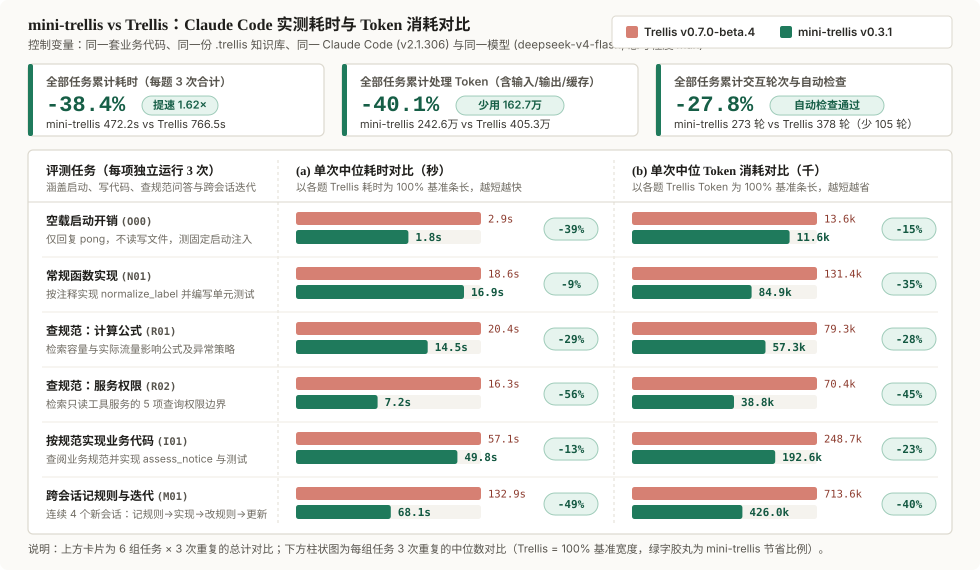

# mini-trellis v0.3.1 — DeepSeek Harness and Cursor

DeepSeek Harness 可以安装项目技能。Cursor 可以在本地会话开始时注入短入口。两边都不解析本机对话历史。OpenCode 和 Pi 仍然没有精确 compact。

## 用户能感受到的变化

- **DeepSeek Harness**：`mini-trellis init --dsh` 和 `refresh --dsh` 把查找、记录和 spec 短技能写到 `.dsh/skills/`。没有可供写入的项目级 SessionStart。需要项目知识时，模型自己执行 `mini-trellis mem recall`；摘录不够再 `mem read`；确认决定后使用 `mini-trellis-remember`。`doctor` 能看到这个宿主。`~/.dsh/sessions` 里的压缩转录本未支持。
- **Cursor 本地**：`init --cursor` 写入 `.cursor/skills/` 和只含 `sessionStart` 的 `.cursor/hooks.json`。启动注入沿用现有短入口。记录入口是 `mini-trellis-remember`。
- **Cursor 云端**：托管云端 Agent 不运行 `sessionStart`。项目技能可以随仓库走，启动注入这一层未支持。
- **本机历史**：Cursor 对话没有解析器。查项目笔记仍用 `mem recall` / `mem read`。

DeepSeek Harness 仍是开发者预览。2026-10-23 在 dsh 0.2.1-rc.2 上完成了一条四会话冒烟验证：记录决定 → 新会话召回 → 更新同一主题 → 再次召回。实际核对了主题内容、两条 journal 的相对链接与 index，没有产生 Git 提交。Cursor 的安装和本地 hook 协议已有自动化验证，IDE 内实际交付待验证。

## 同任务对比

2026-10-22，在 Claude Code 2.1.306、同一模型和同一份合成项目资料下，比较 mini-trellis 0.3.1 与 Trellis 0.7.0-beta.4。两边使用相同项目代码、业务知识、模型和思考程度，分别正常安装各自的项目集成。

本批次六组任务各重复三次，mini-trellis 累计耗时减少 **38.4%**，累计处理 token 减少 **40.1%**，Claude Code 统计的交互轮次减少 **27.8%**。处理 token 包含缓存读取，不等同于账单费用。



### 环境与任务

| 项目 | 配置 |
| --- | --- |
| 产品 | mini-trellis 0.3.1；Trellis 0.7.0-beta.4 |
| 宿主 | Claude Code 2.1.306 |
| 模型配置 | `neolink/developer/anthropic/deepseek-v4-flash`，effort `max`；底层模型快照未披露 |
| 安装 | 空白 Git 项目中标准初始化，再放入相同业务材料；保留各自默认指令与 hook |
| 业务材料 | 三个 Python 模块、四份后端规范、一篇背景笔记 |
| 重复方式 | 每组任务三次；每次使用独立项目与宿主历史目录；跨会话任务的四个阶段共享该次项目 |
| 样本 | 每侧 15 次单会话任务、3 条四阶段使用链，共 27 个会话；试跑不计入 |

六组任务分别是：直接回复 `pong` 的启动开销；实现普通字符串函数；查询计算规则；查询工具权限；按项目规则实现计算函数；记录重试规则后跨会话实现、修改规则并再次更新实现。

### 逐题结果与累计值

下表为每组三次重复的中位数（跨会话一行将四个阶段相加后，再取三条链的中位数）：

| 任务 | 耗时：mini / Trellis | 交互轮次：mini / Trellis | 处理 token：mini / Trellis |
| --- | ---: | ---: | ---: |
| 启动开销 (`O00`) | 1.8 / 2.9 秒 | 1 / 1 | 11,568 / 13,577 |
| 普通函数实现 (`N01`) | 16.9 / 18.6 秒 | 8 / 12 | 84,894 / 131,354 |
| 查询计算规则 (`R01`) | 14.5 / 20.4 秒 | 10 / 9 | 57,250 / 79,308 |
| 查询工具权限 (`R02`) | 7.2 / 16.3 秒 | 5 / 9 | 38,827 / 70,435 |
| 按规则实现计算 (`I01`) | 49.8 / 57.1 秒 | 16 / 22 | 192,589 / 248,742 |
| 跨会话记录与更新 (`M01`) | 68.1 / 132.9 秒 | 49 / 72 | 425,957 / 713,587 |

全部正式样本的累计值如下（所有重复的实际数值之和）：

| 指标 | mini-trellis | Trellis | 本批次减少 |
| --- | ---: | ---: | ---: |
| 耗时 | 472.2 秒 | 766.5 秒 | 38.4% |
| 处理 token | 2,426,377 | 4,052,930 | 40.1% |
| Claude Code 交互轮次 | 273 | 378 | 27.8% |

- 耗时为启动命令到结束的墙钟时间，包含工具执行；处理 token 为未缓存输入、输出与缓存读取之和。
- 正式样本均正常结束；普通实现、业务实现和跨会话两次实现均通过外部单元测试检查，两道只读题通过公式探针、布尔值与引文匹配自动检查。
- 题目设计、每次运行的逐轮明细与跨会话四阶段拆解见 [完整评测细节](./benchmark-detail.md)。评测运行器、夹具和原始轨迹保留在本地。

## 兼容性

OpenCode 和 Pi 还没有精确会话恢复。查笔记仍用 `mem recall` / `mem read`。要看本机历史时，用 `mem list --platform opencode` 或 `--platform pi`，再用完整 id 调 `mem context`。

## 升级与核对

升级前请备份项目知识和自定义配置，包括被 Git 忽略的文件。

已有 mini-trellis 项目：

```sh
mini-trellis upgrade
mini-trellis refresh --dry-run
mini-trellis refresh --dsh
mini-trellis refresh --cursor
mini-trellis doctor
```

`upgrade` 更新全局 CLI。`refresh` 只更新受管理且未被本地修改的文件，保留 `.trellis/spec/`、`research/`、`workspace/` 和用户自己的配置。只刷新实际使用的宿主。完成后开启新会话。Codex 仍需分别信任项目和 hook。

从 Trellis 迁入仍使用 `mini-trellis migrate --dry-run`，确认后再执行 `mini-trellis migrate`。
