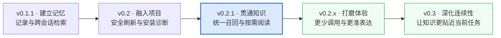
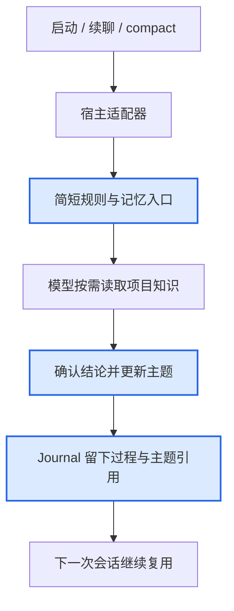
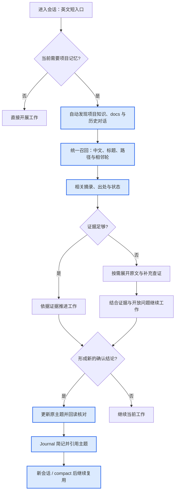

# mini-trellis · 产品路线图

**Less ceremony. More continuity.**

让每一次开发，都站在项目已经积累的知识之上。

mini-trellis 为 AI 编程提供轻量的项目记忆：把确认过的决定留下来，把相关证据找回来，让下一次会话自然接上进度。知识保存在项目里的 Markdown 中，随代码一起阅读、演进与复用。

更新：2026-10-12。v0.2 已发布；v0.2.1 贯通统一召回、知识记录与上下文恢复，核心开发与 Codex、Claude Code 验收完成。

## 从记住，到用好

| 版本 | 核心体验 | 进度 |
| --- | --- | --- |
| v0.1.1 | 为四个宿主建立记忆入口，连接笔记与历史对话 | 基础版本 |
| v0.2 | 配置安全合并，工具资产可刷新，安装状态可诊断 | 已发布 |
| v0.2.1 | 文档与对话统一召回，短证据先读，原文按需展开，确认决定衔接主题与 journal | 核心开发与验收完成 |
| v0.2.x | 打磨查询、事件去重和记录表达，让记忆更省心 | 后续体验优化 |
| v0.3 | 深化任务相关性、知识沿革与工作连续性 | 产品演进方向 |

## v0.2.1 · 项目知识，一处召回

项目规则、研究笔记、docs 和历史对话进入同一条检索链路。一个 `mem recall` 返回相关摘录、来源与定位；需要更多细节时，用 `mem read` 展开原文。文档自动发现，现有项目知识直接成为模型可用的上下文。

| 能力 | 用户获得的体验 |
| --- | --- |
| 统一召回 | 从项目文档与历史对话中找到相关依据，减少来回寻找 |
| 渐进阅读 | 先看短证据，再展开所需原文，让上下文围绕当前问题组织 |
| 自然沉淀 | 确认决定后更新已有主题，用 journal 留下过程与引用 |
| 会话连续性 | 启动与 compact 恢复时提供简短入口，延续项目知识 |
| 运行诊断 | doctor 展示最近 hook 执行与记录结果，定位实际运行状态 |
| 大目录发现 | 批量处理 Git 忽略检查，让文档发现适应更大的项目 |

### 从宿主事件，到可用记忆

### 一次完整的知识循环

### 真实使用链验证

v0.2.1 已完成 Codex 与 Claude Code 的确认记录、新会话召回、同主题更新、用户否定、普通修改和写失败验收，并验证真实交互 `/compact` 后的 hook 交付与恢复。

- **442 项自动化测试通过**，覆盖检索、记录、宿主契约与边界行为。
- **Claude Code：36 步核心验收完成**，15 个写入步骤的主题、journal 与 index 实际核对完整。固定模型为 `neolink/developer/anthropic/deepseek-v4-flash`。
- **Codex：7 类独立场景各验证 3 次**，三个项目完成连续使用与真实 compact 恢复。固定模型为 `gpt-5.6-luna`。
- **Node 18.17 与 25.9 实际打包验证完成**，覆盖安装、召回、刷新和旧版升级。

## 下一步 · 更少打断，更高复用

### v0.2.x · 把体验磨细

围绕真实使用中的成本打磨细节，让模型用更少的动作获得足够的依据。

- **查询更直接**：改善中文与英文资料间的关键词匹配，减少重复改写和命中后的再次查询。
- **上下文更精简**：优化 resume 与 compact 相邻发生时的入口交付，让恢复上下文更紧凑。
- **记录更准确**：让简短概括保留确认范围，完成说明与实际文件更加一致。
- **安装更顺畅**：持续改善首次安装、已有项目升级与宿主诊断体验。

### v0.3 · 让记忆更贴近工作

在统一召回之上深化项目连续性，把“能找到”推进到“更容易用对”。

- **任务相关性**：结合当前文件、代码路径和问题主题，让最相关的依据更早出现。
- **知识沿革**：让当前规则、历史决定与替代关系更清晰，减少重新讨论和使用旧结论的成本。
- **连续工作体验**：打通跨会话接续与 compact 恢复，让项目上下文伴随工作自然演进。
- **效果评测**：用真实项目反馈和固定材料持续衡量召回质量、记录准确性、上下文与调用成本。

## 轻量，贯穿每一层

**项目里的 Markdown，是记忆的长期载体。** 人与模型共享同一份知识，直接阅读、直接编辑、随项目演进。

**按需提供上下文，是交互的默认节奏。** 短入口负责引导，相关证据支撑当前问题，完整内容在需要时展开。

**本地词法检索，是简单可维护的技术底座。** 文档自动发现，沿用现有宿主会话与文件结构。

**语言跟随知识本身。** 默认提示词英文，新笔记使用讨论或指定语言，更新沿用原文语言。

**四个宿主共享记忆体验。** Codex、Claude Code、OpenCode 与 Pi 使用一致的知识结构与记忆入口，真实体验优先围绕 Codex 和 Claude Code 打磨。

## 设计灵感

| 项目 | 吸收的设计思想 |
| --- | --- |
| Trellis 0.7.0-beta.4 | 项目知识结构、路径规则、宿主事件与恢复机制 |
| Comet 0.4.4 | 条件式记录、主题更新、中文与路径查询、上下文预算 |
| QMD 研究快照 | 中文匹配评测、检索与原文阅读分层 |
| Claude-Mem 研究快照 | 渐进展开、事件过滤与记忆去重 |

从成熟项目中吸收有效设计，把它们凝练为 mini-trellis 简单、自然、持续可用的项目记忆。

继续了解：[使用说明](../README_CN.md) · [English README](../README.md) · [v0.2 发布记录](releases/v0.2.0.md)。
