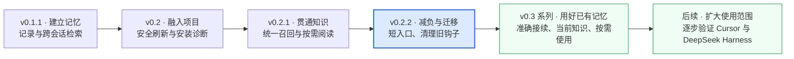
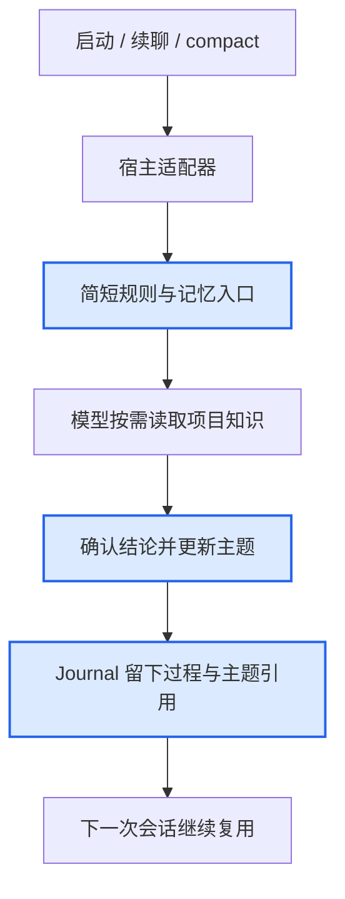
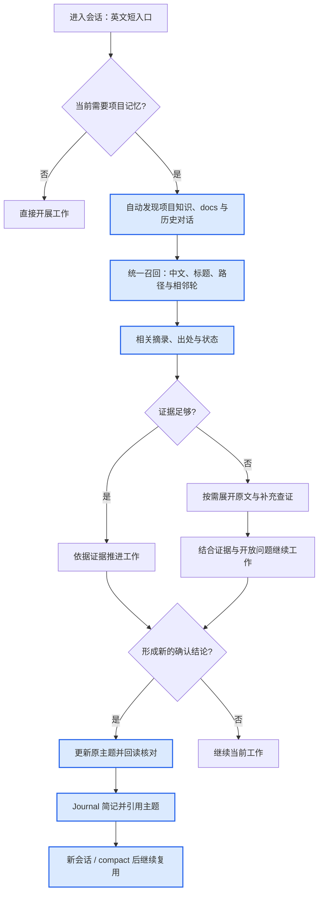

# mini-trellis · 产品路线图

**Less ceremony. More continuity.**

让每一次开发，都站在项目已经积累的知识之上。

mini-trellis 为 AI 编程提供轻量的项目记忆：把确认过的决定留下来，把相关证据找回来，让下一次会话自然接上进度。知识保存在项目里的 Markdown 中，随代码一起阅读、演进与复用。

更新：2026-10-16。0.2.2 已发布。后续围绕功能主干、研究、维护、文档、平台扩展与评测推广持续推进，按用户能感受到的成果拆分版本。0.3 系列优先打磨记忆复用，具体小版本范围在开发启动时确定。

本文负责产品方向和阶段安排；[0.3 及后续开发计划](development-plan.md) 列出功能细节、代码入口、边界、依赖与验收，供交接给 Cursor 使用。旧蓝图、画布与需求池保留为研究背景，其中较早的版本分配以本轮路线为准。

## 从记住，到用好

| 版本 | 核心体验 | 进度 |
| --- | --- | --- |
| v0.1.1 | 为四个宿主建立记忆入口，连接笔记与历史对话 | 基础版本 |
| v0.2 | 配置安全合并，工具资产可刷新，安装状态可诊断 | 已发布 |
| v0.2.1 | 文档与对话统一召回，短证据先读，原文按需展开，确认决定衔接主题与 journal | 已发布 |
| v0.2.2 | 启动入口再缩短；迁移清理旧 hook、Pi 扩展和 Codex 递归限制，并保留用户配置 | 已发布 |
| 近期补丁与准备 | 处理实际阻塞、完善上手说明、固定评测材料 | 持续进行，不等待大版本 |
| v0.3 系列 | 精确会话恢复、知识沿革、召回与展开优化、经验证的相关线索 | 分批交付，具体小版本范围待确定 |
| 平台扩展与后续 | Cursor 优先验证，DeepSeek Harness 先研究接入与原生记忆共存 | 按能力成熟度发布，不固定为某一个版本 |

## v0.2.1 · 项目知识，一处召回

项目规则、研究笔记、docs 和历史对话进入同一条检索链路。一个 `mem recall` 返回相关摘录、来源与定位；需要更多细节时，用 `mem read` 展开原文。文档自动发现，现有项目知识直接成为模型可用的上下文。

| 能力 | 用户获得的体验 |
| --- | --- |
| 统一召回 | 从项目文档与历史对话中找到相关依据，减少来回寻找 |
| 渐进阅读 | 先看短证据，再展开所需原文，让上下文围绕当前问题组织 |
| 自然沉淀 | 确认决定后更新已有主题，用 journal 留下过程与引用 |
| 会话连续性 | 启动与 compact 恢复时提供简短入口，延续项目知识 |
| 运行诊断 | doctor 展示最近 hook 执行与记录结果，定位实际运行状态 |
| 大目录发现 | 批量处理 Git 忽略检查，让文档发现适应更大的项目 |

### 从宿主事件，到可用记忆

### 一次完整的知识循环

### 真实使用链验证

v0.2.1 已完成 Codex 与 Claude Code 的确认记录、新会话召回、同主题更新、用户否定、普通修改和写失败验收，并验证真实交互 `/compact` 后的 hook 交付与恢复。

- **442 项自动化测试通过**，覆盖检索、记录、宿主契约与边界行为。
- **Claude Code：36 步核心验收完成**，15 个写入步骤的主题、journal 与 index 实际核对完整。固定模型为 `neolink/developer/anthropic/deepseek-v4-flash`。
- **Codex：7 类独立场景各验证 3 次**，三个项目完成连续使用与真实 compact 恢复。固定模型为 `gpt-5.6-luna`。
- **Node 18.17 与 25.9 实际打包验证完成**，覆盖安装、召回、刷新和旧版升级。

## 下一步 · 让项目积累减少下一次开发的负担

### 六个持续方向

| 方向 | 具体工作 | 详细计划 |
| --- | --- | --- |
| 功能主干 | 留下有用知识、找回正确依据、在需要时使用、跨会话接续 | [F1–F6](development-plan.md#features) |
| 学术与技术研究 | 将事件线索、压缩恢复、知识时效和上下文预算等研究转成可验证假设 | [研究方法](development-plan.md#research) |
| 遗留问题修复 | 安装迁移、模板同步、文件一致性、宿主交付和性能边界 | [维护清单](development-plan.md#maintenance) |
| 使用说明 | 从零开始、从 Trellis 开始、功能概览、日常用法和排障 | [文档工作包](development-plan.md#documentation) |
| 平台扩展 | Cursor 本地优先，DeepSeek Harness 先验证接入方式，按能力列支持状态 | [平台计划](development-plan.md#platforms) |
| 评测与推广 | 对比质量、速度、上下文成本和业务共识复用，形成可复现实验与演示 | [实验和推广](development-plan.md#evaluation) |

### 功能主干的重点

- **记录质量**：沿用已有 remember 与记录脚本，针对实际遗漏改进。确认后更新同一主题，保留条件、来源和已验证的失败，journal 简记并引用。
- **知识沿革**：用可选替代关系区分现行与历史内容。当前问题优先使用适用的新结论，历史原因仍能查到；来源变化只提示复核，不自动判定规则失效。
- **召回与减负**：从固定漏查和重复调用入手，改善词法、标题、路径与标识符匹配。摘录足够后停止查询，需要条件或原话时再展开。
- **会话连续性**：compact 后提供准确的会话入口，新会话与跨宿主按需找回背景。先复用已有 list 和会话读取能力，再判断是否需要新命令。
- **条件式提示**：有可靠关联时试验 1–2 个笔记路径线索，干净工作区和无关联任务保持短入口；先测正确使用率、误提示和新增开销。
- **运行可见性**：分别核对资产、hook 运行、上下文交付、模型使用和实际写入。doctor 只报告掌握的事实，没有真实运行证据时保持 unknown。

统一召回、短入口、基础 compact 恢复和最近写入诊断已有实现。后续以这些能力为底座，避免将历史修复重复列为新功能。

### 建议交付顺序

1. **确认基线**：核对主分支和既有草稿，整理真实阻塞，补充使用说明与固定实验场景。
2. **优先主干**：先做精确会话恢复，再做知识沿革。两条都改召回和启动入口，分开交付。记录质量和诊断缺陷随实际复现修补。
3. **基于结果优化**：查询与展开减负、少量路径提示。路径提示在相关任务用对、无关任务没有变吵之前，不进默认启动。
4. **扩大使用范围**：平台接入调研可以提前进行，正式支持按分层验收交付；演示与推广使用已测成果。

三个已有草稿先审阅其实现与证据，不自动合并或重写。每次发布围绕一个清楚的用户体验改进，带上必要修复、文档与验证；不要求所有方向在同一个版本完成。

### 使用与效果如何一起交付

[开发时怎么用](./using_CN.md) 与 [Using it while you code](./using.md) 继续围绕一次回调修改，展示记录、召回、主题更新和后续复用。新项目与旧 Trellis 项目分别走通上手路径，再进入同一份日常指南。

实验分别回答：相同资料下 mini-trellis 是否优于原生宿主、与固定版本 Trellis 相比成本如何、某项新增机制是否有净收益。质量、耗时、实际调用和上下文量一起报告；字符数与 token 分开，失败、超时和未验证环境如实列明。

推广以“少重复解释、少重复摸索、持续复用业务共识”为主线。README、短演示和社区文章引用相应实验，不把论坛热度或其他项目的数据当成本项目效果。

### 保留在候选池的内容

指定旧会话起草 research、知识关系检查、只卸工具保留知识等继续作为独立候选，出现明确需求后按小版本处理。默认本地词法检索、按需展开和项目 Markdown 的边界保持清楚；嵌入模型、后台总结和重型索引不在本次路线中。

## 轻量，贯穿每一层

**项目里的 Markdown，是记忆的长期载体。** 人与模型共享同一份知识，直接阅读、直接编辑、随项目演进。

**按需提供上下文，是交互的默认节奏。** 短入口负责引导，相关证据支撑当前问题，完整内容在需要时展开。

**本地词法检索，是简单可维护的技术底座。** 文档自动发现，沿用现有宿主会话与文件结构。

**语言跟随知识本身。** 默认提示词英文，新笔记使用讨论或指定语言，更新沿用原文语言。

**四个宿主共享记忆体验。** Codex、Claude Code、OpenCode 与 Pi 使用一致的知识结构与记忆入口，真实体验优先围绕 Codex 和 Claude Code 打磨。

## 设计灵感

| 项目 | 吸收的设计思想 |
| --- | --- |
| Trellis 0.7.0-beta.4 | 项目知识结构、路径规则、宿主事件与恢复机制 |
| Comet 0.4.4 | 条件式记录、主题更新、中文与路径查询、上下文预算 |
| QMD 研究快照 | 中文匹配评测、检索与原文阅读分层 |
| Claude-Mem 研究快照 | 渐进展开、事件过滤与记忆去重 |

从成熟项目中吸收有效设计，把它们凝练为 mini-trellis 简单、自然、持续可用的项目记忆。

继续了解：[使用说明](../README_CN.md) · [English README](../README.md) · [v0.2 发布记录](releases/v0.2.0.md)。
